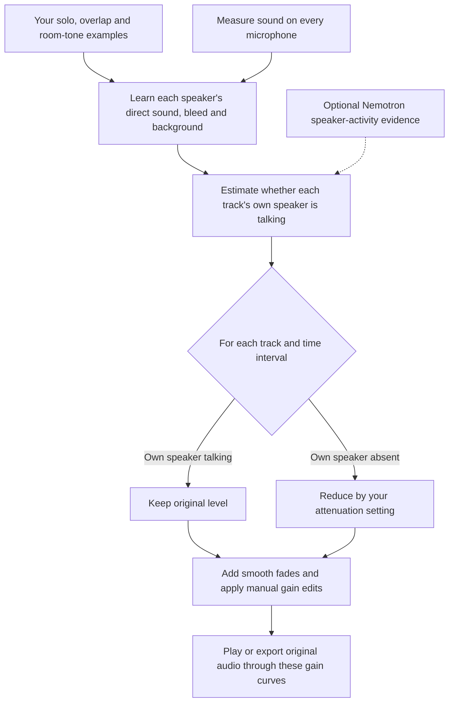

# CleanSlate GUI and attenuation design

Status: owner-confirmed design and evaluation direction, 2026-10-09

This consolidates the owner's confirmed design-interview answers. Documentation and ticket consolidation are authorized; implementation, builds and audio processing remain deferred. GUI decisions 07–11 feed one new build ticket 16. Acoustic-first evaluation from decision 12 extends existing ticket 14. The existing Rust/Iced architecture remains.

## Intended workflow

Open a project or import tracks. Show the tracks together and prepare playback automatically with concise progress. Original playback works independently of model setup, references and unverified start alignment, provided sources are otherwise valid and timing is compatible. Show actual timing conflicts clearly. Equal duration is useful compatibility evidence, not proof of synchronized starts. Keep the timing decision needed for analysis/export visible rather than buried in the inspector.

Click a waveform to seek. Drag to select a range. Show compact labeling actions beside the pointer immediately after dragging, with no selection mode to enter or finish. Offer each configured solo speaker, multiple-speaker overlap and room tone/no talking. Provide keyboard access and dismissal; clamp at viewport edges. Capture interactions so they cannot seek or edit behind the actions. Bind each new selection to its track and prevent reuse of another track's old selection.

A label states who is talking during that interval across the entire session. Speaker 1 solo means Speaker 1 is talking and the other assigned speakers are not. Overlap selects everyone talking. Room tone means nobody is talking. Preserve explicitly labeled speakers unless the owner intentionally edits their gain. Keep existing source validation, conflict replacement, undo/redo, save/reopen and stale-analysis behavior.

The owner supplies a few clear solo examples for each speaker and room-tone examples, potentially from the beginning, middle and end or wherever clearest. These are representative training examples, not an exhaustive annotation requirement. Analyze remains explicit after reference changes. Gain/fade changes update audition and envelopes without retraining. Ordinary click-to-seek remains available throughout labeling.

## Visible controls and cache

Use one persistent workspace with concise readiness and a next useful action. Keep tracks and transport visible. Reduce inspector text and collapse technical/setup details. A working installed model shows compact ready status; recovery actions appear when needed. Keep required notices and provenance accessible.

Use a shared waveform cache keyed by audio identity so another project using the same audio can reuse display data. Do not add one waveform sidecar per project. Specify trustworthy source-change detection, recipe/version checks and safe cache writes before implementation. Cache data remains rebuildable; missing or corrupt cache must not lose project labels or edits. Audio files and saved projects stay untouched. Treatment of old project caches requires a documented migration, not unsolicited deletion.

Automatically prepare playable audio when tracks open and reuse compatible prepared data. Display waveform peaks and playable samples are different caches. Show progress, cancellation and a specific reason for unavailable transport. Measure cold and warm playback readiness rather than promising instant first playback. DAW behavior, with FL Studio and REAPER cited by the owner, is the interaction goal.

## Automatic attenuation direction

Evaluate acoustic-first supervised analysis with Nemotron optional before committing to removal. The evaluation should establish whether human references and acoustic evidence can identify absent speakers and reduce bleed effectively on the owner's recording. The existing required-Nemotron design has not yet been revised. Optional use, model-feature availability and reference readiness need concrete implementation contracts after the evaluation direction is confirmed.

The owner prioritizes useful main attenuation and does not want uncertain-region review to dominate the workflow. Uncertainty alone should not automatically veto attenuation when usable evidence supports reducing a track. If identity/model evidence is missing, attempt an acoustically supported decision rather than preserving the entire track by default. Missing evidence alone cannot establish absence. Explicit human speech/overlap labels remain protected.

Use adjustable attenuation and finite fades, not mandatory hard muting. Reuse existing gain/fade controls and the common effective-envelope evaluator. Keep training labels separate from manual sound edits.

An evaluation must distinguish probability/classifier failures from a later temporal preservation veto or gain-generation behavior. A less conservative policy must reach the effective envelope, audition and export, not merely change displayed probabilities. Compare equivalent references/settings and keep independent evaluation regions separate from training/tuning. Report wanted-speech/overlap impact and bleed reduction separately. Owner listening decides whether the practical result is acceptable; acoustic-first feasibility does not establish recording quality.

## Proposed flow

### What you do

Opening tracks loads reusable waveforms and starts playback preparation automatically. You can listen in Original before labeling or analysis. Saving the project is available throughout; exporting requires current analysis.

If detection is wrong, correct or add a reference and Analyze again. If detection is right but the reduction sounds too strong or weak, adjust gain/fades and listen again without retraining.

### What Analyze learns and applies

The proposed acoustic-first experiment learns from your examples, then estimates each speaker's activity throughout the recording. It does not require you to label every speaking interval.

For example, a Speaker 1 solo reference teaches what Speaker 1 sounds like on their own microphone and how much of that voice appears on microphones 2 and 3. Later, hearing that same leakage pattern on microphone 2 should support reducing track 2 when Speaker 2 is absent. Overlap permits multiple tracks to remain at their original level.

The talking/absent branches are estimates outside your labeled examples, not guaranteed truth. Explicit human speech labels remain protected; manual gain edits can intentionally change them. An uncertainty flag should not automatically veto evidence-supported reduction under the proposed policy. Nemotron is an optional source of additional activity evidence in this experiment, not another action you must perform in the editing flow.

This diagram describes the proposed evaluation direction. The shipping design still requires Nemotron until a revision is accepted and tested. The current accepted pipeline is documented in [the feedback explanation](gui-feedback.md).

## Ticket scope and confirmation

Decisions [07](issues/07-audio-waveform-cache.md) through [12](issues/12-attenuation-policy.md) are resolved planning records, not six separate implementation jobs. [Build ticket 16](../offline-supervised-editor/issues/16-gui-editing-workflow.md) consolidates the GUI/cache/playback work. [Existing ticket 14](../offline-supervised-editor/issues/14-independent-release-evaluation.md) covers acoustic-first evaluation after a usable GUI candidate. Release qualification remains blocked until the independent quality/performance/listening gates pass. Existing unverified controller/canvas work stays preserved for later reuse.

Unsettled empirical outcomes are acoustic-first recording quality, suitable thresholds and reduction defaults, cold/warm playback latency, and actual GUI usability. These require future measurements; they are not unanswered storage or workflow preferences.
