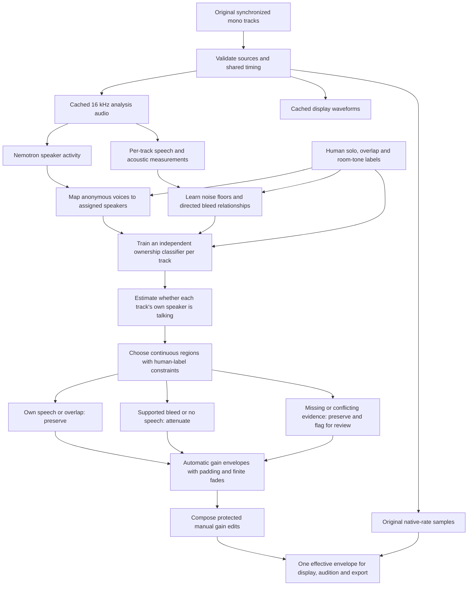
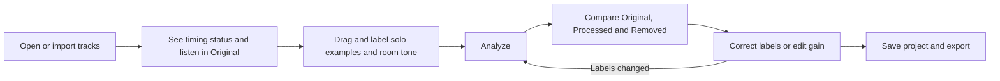

# GUI workflow feedback and design interview

Status: draft decisions, 2026-10-09

The owner requested documentation and grilling before further implementation. These observations concern the last verified owner-ui candidate, not the unfinished right-click implementation. The accepted specification remains in force until the owner confirms revised decisions. Existing uncommitted controller/canvas work is preserved in the offline-timebase worktree; its verification build was stopped to allow GUI inspection.

## Recording and observed friction

The local test directory is `C:/Users/User/Documents/Codex/2026-08-14/podcast-automix-rust-gui/test-audio`. Sources are `261005-channel-1.wav`, `261005-channel-2.wav`, and `261005-channel-3.wav`; the saved reference project is `261005-supervised.cleanslate`. Do not overwrite sources or the saved project during design experiments.

The owner reports duplicate project waveform files, including `261005-supervised.waveforms.json` and `CleanSlate.waveforms.json`, and wants waveform reuse tied to audio rather than projects. The screenshots show installed-model status alongside prominent download/verification actions, lengthy reference instructions, a selection mode requiring Finish selecting, and the supplied-synchronization checkbox deep in the inspector. Playback was disabled until that checkbox was selected. First playback then displayed Preparing audio. The order of operations is unclear.

The requested interaction is ordinary waveform click to seek, drag to select, then an immediate label action on that range. Labels should describe Speaker 1, 2, 3 or any configured speaker, multiple speakers together, or no talking/room and microphone noise. The owner also questions whether automatic attenuation must remain as conservative as it is today.

## Current accepted algorithm

This diagram describes the accepted pipeline in [spec.md](spec.md), not a quality guarantee. References teach a small per-recording classifier; they do not fine-tune Nemotron.

A Speaker 1 solo label tells the system that Speaker 1 is active and the other assigned speakers are not active in that interval. Comparing all microphones there teaches how Speaker 1 sounds directly and how that voice leaks into the others. Room tone teaches background levels. Overlap allows multiple owners simultaneously. These relationships help classify the rest of the recording, but microphone movement, quiet speech, similar voices and ambiguous speaker mapping can make a new interval differ from the examples.

Attenuation reduces the original samples using gain curves. It does not subtract a reconstructed voice or replace the recording with resampled analysis audio. Human labels constrain their intervals; they do not establish ground truth for every unlabeled interval. Gain edits control the final sound separately from training labels.

The independent-speaker repair allows resolved speakers to be modeled while an unresolved speaker remains preserved. Missing evidence is still not evidence of silence. The amount of actual unnecessary preservation on this recording needs diagnosis and listening evidence before changing that rule.

## Why the current cache and playback behave this way

Verified in the existing worktree: `waveform::load_or_build_progress` uses the project path with a `.waveforms.json` extension. It checks the entire ordered source list using path, byte length and modification time. A different project name selects a different cache file, so the same audio can be decoded again. Cache reuse is therefore currently project-bound. The storage redesign must also decide whether to strengthen those identity checks.

Original playback currently calls `editor_workflow::original_envelopes`, which requires alignment before constructing unity envelopes. The Play button and Space ultimately reach that same gate. That explains why the supplied-alignment declaration enabled playback; Stop is unavailable when neither playback nor preparation is active.

`audition::PreparedAudio::prepare_at_rate` builds disk-backed playback audio at a common playback rate, checks sources/cancellation and reuses compatible source stamps and rate on later requests. Display waveforms contain peaks, not the actual samples needed to play sound. Preparing audio therefore means playback preparation, not running the ownership analysis. The interview should decide when to start that work and how to show its progress.

Source pointers: `src/waveform.rs` cache loading, `src/audition.rs` preparation, `src/app.rs` audition/transport, `src/editor_workflow.rs` Original envelopes, and `src/engine.rs` alignment checks. Model behavior is also described in `docs/supervised-ownership-models.md` and `docs/temporal-ownership.md`.

## Proposed visible workflow

This is a recommendation for the interview, not an accepted UI specification. Keep one workspace, with a short status and the next useful action instead of a staged wizard.

Equal durations are compatible with synchronization, but equal-length files can have different start offsets. Timing metadata can provide additional evidence; missing metadata leaves alignment unverified under the current contract. Automatic alignment is outside the accepted release scope. Whether unverified timing should block Original audition separately from analysis/export is an open decision.

## Draft decision tickets

These tickets require owner answers and then a confirmed specification before implementation. They are part of the existing migration roadmap, not a replacement roadmap or completed build tickets.

- [07 Reuse audio waveform caches](issues/07-audio-waveform-cache.md)
- [08 Simplify installed model controls](issues/08-model-status-controls.md)
- [09 Make timing and playback readiness clear](issues/09-timing-playback-readiness.md)
- [10 Label directly on waveform tracks](issues/10-direct-track-labeling.md)
- [11 Clarify the editing workflow](issues/11-editor-workflow-guidance.md)
- [12 Decide automatic attenuation behavior](issues/12-attenuation-policy.md)

## Decision tree

### First round owner answers

2026-10-09: The owner accepts compact installed-model status, Original audition before alignment confirmation, immediate labeling actions after dragging, and concise workflow guidance. Cache placement is delegated for recommendation; recommend a shared application cache keyed by audio identity, pending confirmation. The owner explicitly permits uncertain regions to be attenuated and reports obvious speaker-absent regions remaining preserved. This is a request to revise the automatic uncertainty policy, not permission to override trusted human labels, guess identities or assume missing evidence means silence.

Immediate labeling supersedes the prior right-click-primary proposal. Keep normal click-to-seek and drag-to-select behavior; decide whether actions appear by the pointer or in a fixed compact area. Existing unverified menu code may be reused only where it fits the confirmed interaction.

### Second round frontier

### Second round owner answers

2026-10-09: Accept shared audio-identity waveform cache, pointer-adjacent actions immediately after dragging, session-wide active-speaker labels, preservation of explicitly labeled speakers, and automatic playback preparation when tracks open. Playback should behave like a DAW, with FL Studio and REAPER cited as interaction references. These references do not select either application's implementation or imply an achievable first-play latency without measurement.

The owner wants main attenuation working before spending attention on uncertain-region review. Do not make uncertainty review a prerequisite to useful automatic attenuation. The exact reduction policy is still unresolved; the owner did not select a specific threshold or gentler gain setting.

The owner prefers attempting attenuation from acoustic evidence when identity/model evidence is missing and asks whether Nemotron is necessary. An acoustic-only supervised classifier is possible in principle, but the current implementation and accepted release contract require Nemotron. Removing that requirement or adding an optional acoustic path is an architectural decision still to be confirmed. An acoustically supported estimate must remain distinct from simply treating missing evidence as silence. Its usefulness on the owner recording is unqualified.

### Third round frontier

### Third round owner answers

2026-10-09: Accept evaluation of acoustic-first analysis with optional Nemotron before committing to removal. The owner will label only a few clear representative sections across the podcast, such as beginning, middle and end or wherever speech is clearest. Automatic analysis must generalize beyond those examples. Use adjustable attenuation rather than complete muting. See [consolidated design](gui-design-summary.md) for the reviewable result. Final shared-understanding confirmation remains pending; documentation only.

Choose whether to retain required Nemotron with acoustic fallback, make it optional with acoustic-first analysis, or investigate removing it. Decide whether references are a few examples for generalization or exhaustive truth for the whole recording. Decide whether absent-speaker regions should use the existing attenuation setting or be muted. Once the model-path decision is settled, resolve acoustic-only evidence requirements and qualification; do not pick new dependencies or implement during this interview.

Confirm the recommended shared cache, the position of immediate label actions, and whether a solo/room label applies to the same interval across all tracks. Define the attenuation behavior for uncertain but available model evidence separately from wholly unavailable evidence. Ask for the preferred reduction behavior and whether trusted speech/overlap labels remain protected. Later numerical tuning and release checks depend on those answers. Do not choose thresholds or implement before shared understanding is confirmed.

First-round decisions are independent: cache storage preference, normal model controls, playback before timing confirmation, labeling interaction, workflow guidance, and desired attenuation tradeoff. Cache identity/movement/writability rules depend on storage preference. Preparation timing and progress depend on playback policy. Menu commands and keyboard bindings depend on the selected interaction. Readiness details depend on workflow guidance. Thresholds, unresolved identity handling and release evidence depend on the attenuation decision. Ask those dependent questions in later rounds rather than silently assuming answers.

No implementation, dependency changes, tests, audio processing or new GUI build are authorized by this feedback round. Existing release quality and owner listening gates remain open.
