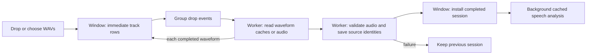

# Responsive import and clear calibration

The Windows drop handler synchronously validated all audio, hashed source identities, built/persisted waveforms, then scheduled analysis. Each file-drop event repeated work on the growing session. Opening/relinking sources also performed these reads on the UI thread.

The fix keeps receipt of files on the window thread and moves the source transaction into a background worker. A 150 ms debounce groups desktop drop events; placeholder rows appear immediately. Additional drops during work queue for the next transaction. Waveforms are published per track before validation and source hashing finish. Hashing streams 64 KiB buffers instead of allocating another entire source file. Analysis remains a separate cached worker after a successful import.

Session editing/export is blocked during the source transaction so edits cannot be overwritten by its snapshot. Scrolling, waveform zoom/pan, additional drops and window events remain available. No loading placeholder is represented as silence. Missing-source saved sessions remain openable for relinking. Worker failure restores access to the prior session.

Calibration now explains microphone comparison, gives a two-step drag/save flow, displays range duration or an actionable invalid-range reason, and disables Save for invalid ranges or legacy mode. Exact-time and existing-selection controls are expandable. The classifier is unchanged.

## Verification

The pre-fix `drop_defers_source_loading_until_background_work` test failed because the project had already been validated/created when the drop handler returned. It passes after the worker change. Other checks cover coalescing, queued drops during loading, intermediate waveform delivery, worker disconnection, invalid-import preservation, open/relink, and invalid calibration ranges.

Optimized full-recording test on the three original `chopshow podcast 155_A01.wav`, `_A02.wav`, `_A03.wav` files: drop handler 0.053917 ms; completed waveform availability 1,802.235479 / 3,377.870441 / 4,934.162023 ms; validated import 12,137.937573 ms. This is source-loading time, excludes speech-analysis completion, and does not measure rendered GUI frame latency. All temporary benchmark project/cache files were removed; source WAVs were not modified and the application was not launched.

Reproduce with `CLEANSLATE_IMPORT_BENCHMARK` set to a semicolon-separated Windows source-path list, then `cargo test --release --locked --lib full_recording_import_timing -- --ignored --nocapture`.

Review caught a partial-relink regression: requiring all siblings to be present before committing one replacement prevented recovery of a session with two missing sources. A failing test reproduced it; individual replacements now validate independently until every unavailable sibling is relinked, then the whole session validates. Exact-time ranges now check the recording end as well as order/duration. Preview cancellation is supplied by the existing `PreviewProcessing::drop`; a new import assertion verifies its cancellation flag is set.
