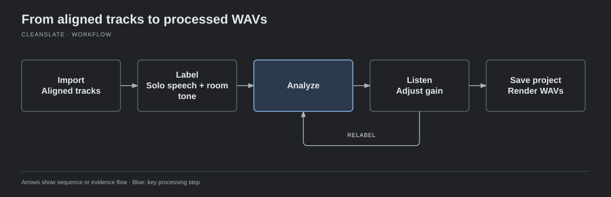
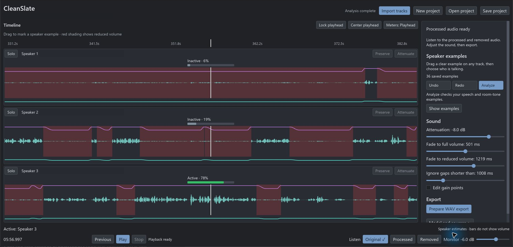

# CleanSlate

CleanSlate is an offline microphone bleed-reduction tool for multitrack podcasts. It uses a supervised algorithm to learn from a few examples of who is speaking, then attenuate each microphone when its assigned person is silent. Listen to the result and adjust the gain where needed.

  
  
  
   
  
  

[Download](#download) · [Usage guide](docs/editor-workflow.md) · [How ownership and bleed work](docs/ownership-explained.md) · [Build from source](docs/development.md) · [Release guide](docs/releasing.md)

## Download

Choose your platform below. CleanSlate runs locally without Python, a model download or an internet connection. Links appear here when packages are published, including alpha prereleases. Draft releases are not public downloads.

<!-- downloads:start -->
| Platform | Download | How to run |
| --- | --- | --- |
| Windows 11, 64-bit | Not published yet | Extract the entire ZIP, then open `CleanSlate.exe`. Keep the support files together. |
| Mac, Apple Silicon, macOS 13+ | Not published yet | Open the DMG and drag `CleanSlate.app` to Applications. |
| Mac, Intel, macOS 13+ | Not published yet | Open the DMG and drag `CleanSlate.app` to Applications. |
| Linux, 64-bit x86, glibc 2.35+ | Not published yet | Allow the AppImage to run as a program in its file properties, then open it. |
<!-- downloads:end -->

On a Mac, **Apple menu → About This Mac** shows either an Apple chip or an Intel processor. Linux packages target Ubuntu 22.04 or newer and require a working desktop and audio system. If your system cannot mount an AppImage, run it with `--appimage-extract-and-run`.

These are experimental alpha packages. Windows builds are unsigned. Mac builds use ad-hoc signing and are not notarized, so the operating system may require approval to open them. Listening quality and long-session qualification remain pending. See the [release guide](docs/releasing.md) for checksums and package checks.

## Try it

CleanSlate is in development. While downloads remain unpublished, use the [build guide](docs/development.md) to build and open the editor from this checkout.

[Accessible diagram and text equivalent](docs/diagrams/workflow.html).

The steps below describe the same workflow. Tracks must already be synchronized; CleanSlate does not align them for you.

1. Import synchronized mono tracks, one dedicated microphone per speaker.
2. Listen in Original mode. Drag across a waveform and select everyone speaking; select nobody for room tone. Supply a solo example for each speaker and a room-tone example.
3. Run Analyze. The learned models evaluate the whole recording, including sections you have not labeled.
4. Compare Original, Processed and Removed. Adjust attenuation, gap duration and fades. Add labels or manual gain edits where needed.
5. Save your editable project and create individual processed WAVs when the result sounds right.

See the [usage guide](docs/editor-workflow.md) for editing, reanalysis and export details.

The development editor after Analyze. Each lane is a microphone track. The gain curve and shaded regions show volume reduction; the percentages estimate whether each track's speaker is active at the playhead. Use **Speaker examples** to teach who is talking, **Sound** to adjust attenuation and fades, and **Original / Processed / Removed** to compare by listening. Recording filenames are redacted. This screenshot illustrates the controls, not an accepted quality result.

## What it does

CleanSlate was created to make podcast microphone bleed reduction practical offline, using the separate microphone tracks and human examples to guide the algorithm. The goal is to reduce unwanted leakage while preserving each speaker's direct speech and natural overlap.

- Learns each recording's speech, room-noise and directed microphone-bleed relationships from human examples.
- Estimates ownership independently for each track, allowing multiple people to speak at once.
- Provides synchronized waveform navigation, gain controls and protected manual edits that survive reanalysis.
- Keeps source files unchanged and uses the same effective gain envelope for display, audition and export.

Automatic attenuation uses S-shaped fades: gain starts changing gently, moves fastest in the middle, then settles gently at the exact target. Open and close controls set the maximum fade durations. The fades fit inside non-speaking gaps and reach full volume before preserved speech. Short automatic gaps can be ignored with the gap control.

Manual gain points use straight lines between points and remain authoritative after reanalysis. See the [gain-envelope contract](docs/effective-envelopes.md) for how these layers combine. The aim is transparent attenuation without audible clicks, pumping or obvious ducking; confirm the result by listening. Existing renders made with the previous exponential fades need to be regenerated.

## Defaults and limits

Analysis uses acoustic measurements and your speaker examples. It runs locally; there is no Nemotron runtime, download or analysis option.

Supply aligned tracks; CleanSlate does not automatically synchronize them. Ownership scores are model estimates, not guaranteed accuracy. Review the result by listening, especially to Removed audio. Independent quality, listening and eight-speaker/two-hour Windows release qualification remain pending.

The planned alpha remains experimental while independent quality, listening and long-session checks are pending. See the [evaluation tracker](.scratch/offline-supervised-editor/issues/14-independent-release-evaluation.md). The earlier Nemotron experiment is retained as a [research idea](docs/research/nemotron.md).

## Documentation and development

### How this project is built

All coding for this project is done with AI agents using GPT Astra and GPT 6.1 Sol. Development follows Matt Pocock's workflow, with specifications, scoped tickets, implementation and review. Human feedback guides the GUI and checks whether the attenuation sounds right.

### Technology

| Component | Technology |
| --- | --- |
| Application and desktop GUI | Rust and Iced |
| Session ownership learning | Linfa logistic regression |
| Fixed speech detection | Silero VAD through ONNX Runtime |
| Audio decoding and analysis resampling | Symphonia and Rubato |
| Playback | Rodio |

### Guides

- [Ownership architecture](docs/ownership-explained.md): labels, acoustic inputs, bleed calibration, weights, logistic regression and gain decisions, with an illustrated workflow.
- [Developer guide](docs/development.md): builds and checks.
- [Release guide](docs/releasing.md): Windows ZIPs, Mac application bundles, Linux AppImages, package checks and draft releases.
- [GUI development](docs/gui-development.md): repeatable build-and-launch workflow using a separate project copy.
- [Technical model recipe](docs/supervised-ownership-models.md) and [acoustic evidence](docs/acoustic-evidence.md).
- [Domain glossary](CONTEXT.md), [architecture decision](docs/adr/0006-offline-supervised-editable-envelopes.md) and [active roadmap](.scratch/offline-supervised-migration/map.md).

For development tasks and known acceptance gaps, consult the [implementation tracker](.scratch/offline-supervised-migration/implementation.md). Read [AGENTS.md](AGENTS.md) before changing the project.
