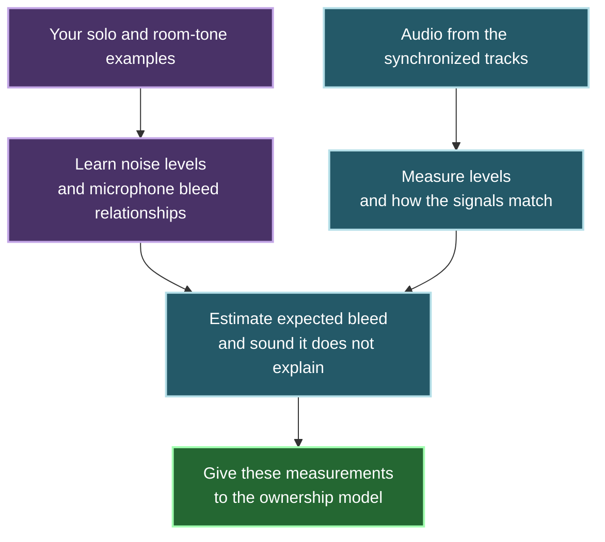

# How CleanSlate measures room noise and microphone bleed

When one person speaks, several microphones can record their voice. CleanSlate compares the synchronized tracks to estimate which sound is direct speech and which sound may be bleed.

This document explains the audio measurements. The [ownership guide](ownership-explained.md) explains how the learned model uses them to decide which sections to attenuate.

## A simple example

Suppose you label a section "Speaker 3 only."

- Track 3 records Speaker 3's direct speech.
- Tracks 1 and 2 record leakage from Speaker 3, plus their background noise.
- CleanSlate compares these tracks to learn the normal leakage into each microphone.

You do not need a separate "bleed" label. Your solo label identifies where the other microphones can provide bleed examples.

A room-tone label identifies a section where nobody speaks. It supplies the background-noise level for each microphone.

## What the tool learns

CleanSlate learns each microphone relationship separately. Speaker 3 leaking into microphone 1 can differ from Speaker 1 leaking into microphone 3.

It starts with a simple estimate of the leakage level. It also checks how closely the signals match after allowing for a short delay. Sound reaches different microphones at different times.

A more detailed filter can account for a small change in the sound as it travels between microphones. The tool uses that filter only when it passes checks on separate parts of the solo examples. Those checks do not prove that it works well on an unseen podcast.

Only solo references fit the bleed relationships. During overlap, the receiving microphone can contain its own speaker too. That makes it unsuitable as a pure bleed example. Overlap labels still teach the ownership model.

## What it measures in the rest of the recording

Every 32 milliseconds, CleanSlate supplies these measurements:

| Measurement | Question it helps answer |
| --- | --- |
| Level above room noise | Is this track louder than its normal background? |
| Level compared with the other microphones | Is this microphone louder than the strongest other microphone? |
| Bleed explanation | How closely does its sound match another microphone after allowing for delay? |
| Expected bleed level | How much leakage does the learned relationship predict? |
| Excess residual | Is there sound that the expected leakage does not explain? |
| Fit reliability | How well did the bleed relationship fit the examples? |
| Calibration availability | Was there enough usable evidence to estimate that relationship? |

"Residual" means sound left unexplained by the bleed estimate. Additional direct speech can increase it. Noise or a changed microphone position can also increase it. The ownership model must consider the other measurements too.

Fit reliability describes the acoustic fit. It is not the probability that a person is speaking.

These measurements do not decide ownership by themselves. Acoustic mode combines them with Silero speech activity in a learned model for each track. Nemotron has been removed from the application; the earlier experiment is retained only as a research idea.

## What happens if the examples are poor?

The tool checks whether the solo source is loud enough above room noise and whether the relationship is consistent.

If it cannot fit a useful relationship, it marks that measurement as unavailable. It does not treat missing evidence as proof of silence. The ownership pipeline still has the other available inputs and its missing-evidence checks.

Microphone movement, level changes and room acoustics can make an earlier estimate less useful. Add clear solo examples of the changed conditions and run Analyze again.

Label changes rebuild the learned relationships. Compatible fixed audio measurements can be reused.

## Does it remove a voice from the audio?

The bleed measurements do not change the source samples. They help the ownership model decide when to reduce gain.

CleanSlate does not subtract a predicted voice from the delivered track. It applies the final gain curve to the original decoded audio. Manual gain edits and protection can correct that result.

## Technical recipe and development evidence

The section below preserves the numerical recipe and fixture results for developers. These are development measurements, not proof of recording quality.

Show thresholds, feature units, filter fitting and test results

### Frozen development recipe

`speechband32ms-trusted-scalar-or-heldout-ridge2tap-lag12ms-v2` reuses existing 150–3000 Hz filtering, 8 kHz decimation and 32 ms level frames. Power/correlation accumulate in f64 to avoid finite float32 squared overflow. Analysis remains 16 kHz with integer source-time conversions. Feature queries are half-open inside every actual native source and stop at the earliest native EOF. A ceil-resampled uneven terminal interval or missing acoustic frame explicitly requests preservation, never another ownership sample. Source samples are never clipped or subtracted.

Trusted room labels establish median per-track speech-band floors (minimum -120 dB relative to a unit sample). Only trusted solos fit directed relationships. Overlap labels affect identity/readiness but never transfer fitting. Stable track IDs bind relationships; reorder invalidates the feature identity.

The scalar model uses median target-minus-source level and median unexplained residual from existing delayed pair correlation. It needs at least three source frames above room floor +6 dB, median explained fraction >=0.75, maximum level deviation <=6 dB, and reliability >=0.7. Reliability is explained fraction times `(1 - deviation/12)`, a development fit score, not calibrated probability. Targets below room floor +3 dB remain explicitly unidentified below-floor evidence. Missing/bad fits have no coefficient/residual and reliability zero.

The offline FIR candidate has two taps, bounded lag +/-12 ms and relative ridge 1e-4. Pinned Nalgebra 0.35.0 Cholesky solves the regularized two-by-two system. There is no handwritten optimizer. The first and last disjoint thirds of every union of overlapping trusted solos provide at most 2048 training and 2048 held-out samples, with a 196-sample guard entirely inside the trusted union; repeated overlapping labels cannot mix held-out and training samples. All references are visited with bounded buffers; training chooses lag/tap orientation, while held-out data never chooses coefficients.

Comparison uses a trained delay-compensated scalar, rather than an unfair zero-delay baseline. FIR needs held-out explained fraction >=0.85, worst reference >=0.7, and residual improvement >=3 dB. Too few above-floor source frames or a below-floor target veto it even with perfect correlation. Plain leakage/small movement retain scalar. Selected FIRs generate immutable per-frame excess residual arrays in bounded 4096-sample multitrack blocks. Feature queries perform no file I/O and retain no full-session PCM/residual waveform.

### Feature units and missing values

The API returns a row per stable track at its covering 32 ms common-time frame.

| Feature | Meaning | Normalization |
|---|---|---|
| Local noise-relative energy | Current speech-band dB minus trusted room floor | Clamp +/-120 dB; divide by 60 |
| Relative dominance | Local dB minus strongest other microphone dB | Clamp +/-120 dB; divide by 60 |
| Incoming pair explanation | Existing delayed squared correlation, either polarity | [0, 1] |
| Expected incoming level | Median target-minus-source dB from trusted solos | Clamp +/-120 dB; divide by 60 |
| Excess residual | dB above that model's trusted residual baseline | Clamp +/-120 dB; divide by 60 |
| Fit reliability | Qualified development fit score | [0, 1] |
| Coefficient-present mask | Identified coefficient versus missing evidence | 0 or 1 |

Scalar excess compares current source-relative unexplained band power with its trusted median. FIR excess compares raw residual/target-power dB with its held-out baseline. Both measure deviation above their own model, never delivered gain. An independent voice or changed relationship raises unexplained residual. A bad fit cannot call that voice bleed. Missing values normalize to zero with coefficient/reliability masks; below-floor evidence remains distinct through its public status and reliability.

Order is local energy, dominance, then five incoming features for each other source in project order (two features for one track; 37 for eight). Actual prepared-payload hashes, source identities, labels, assignments and recipe key fits. SHA is checked cancellably before warm reuse and again before new fits install. Cancellation, I/O failure or source changes retain the accepted cache. Label edits rebuild fits but preserve compatible fixed facts. Final learned-model keys must additionally include ticket 07 mapping and ticket 06 neural provenance.

### Historical development measurements

Four-second, two-track float32 fixtures use exact synthetic solo/room truth and neutral stable IDs. Private recording labels and listening judgment were not inferred.

| Fixture | Observed result |
|---|---|
| 0.2 scalar leakage | Approximately -13.98 dB; reliable scalar |
| 64-sample delayed 0.6/0.4 coloration | Scalar held-out explanation 0.69067854; FIR 1.0 at printed precision; improvement 75.124146 dB; FIR selected |
| Colored copy plus quiet independent signal | Solo excess -0.001386 dB; overlap excess +74.29026 dB; original samples retained |
| Optional overlap label added | Features unchanged; fixed facts retained; derived identity changed |
| Small 0.2→0.25 level change | Scalar retained; level -12.529106 dB, reliability 0.8791418 |
| Independent target noise / 0.05→0.8 change | Unavailable fit; coefficient/residual absent; reliability zero |
| Zero solo signal | Required-reference readiness rejects it |
| Correlated coloration below room tone | Below-floor status retained; no coefficient or FIR promotion |
| Finite samples scaled by 1e20 | Finite normalized features; samples remain unclipped |
| Same-length finite payload tamper | Reuse rejected; previous fit retained |

These ideal fixtures establish mechanics and a limited useful candidate. Two taps/fixed lag cannot cover arbitrary reverberation, nonlinear processing or large microphone changes. The large ideal residual improvement is not real-speech quality. Long-session performance and independent speech/bleed/listening acceptance remain ticket 14. These measurements describe the acoustic development fixtures, not the current GUI's quality.

Primary solver references: [Nalgebra decompositions](https://github.com/dimforge/nalgebra/blob/main/_autodocs/api-reference/03-linear-algebra-decompositions.md), [error handling](https://github.com/dimforge/nalgebra/blob/main/_autodocs/errors.md), [pinned package](https://crates.io/crates/nalgebra/0.35.0).

