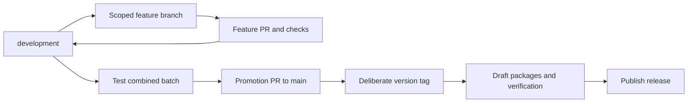

# CleanSlate branches, worktrees and releases

Inventory date: 2026-10-20, America/New_York. This is a snapshot; the workflow below is the ongoing policy. [Ticket 53](../.scratch/offline-supervised-editor/issues/53-development-integration.md) records integration and validation results.

## The everyday process

**One worktree per feature being edited in parallel; one development worktree for testing the combined application.** Sequential features can reuse a clean worktree. You do not need a new worktree for each commit or a new release to test something.

For example, one Codex chat builds feature A on `codex/feature-a` in worktree A, while another builds feature B on `codex/feature-b` in worktree B. Both start from development. Each finishes its ticket, runs its checks, pushes its branch and opens a **GitHub PR whose base is development**. After the PRs merge, your integration worktree pulls development and builds it. That executable now contains A and B together.

The PR is a review and merge request on GitHub; it is not a package download. Pulling updates your existing local files with the merged commits. You then build those files locally. You do not clone the project again, download a release ZIP or repeat this in every feature worktree just to test the combined app.

For an earlier local experiment, create a temporary `codex/try-features` branch/worktree from development, merge the local feature branches into it and build there. Worktrees in this repository share those commits, so this test needs no upload/download. It does not merge the PRs on GitHub. Keep the normal development worktree following the remote PR merges; mixing independent local development merges with GitHub merges can leave divergent histories.

Once the combined app passes checks and your desktop/audio review, open one development → main PR. Prepare a version deliberately, tag the tested source, inspect all four packages in the draft release and publish it. Repeat feature/test cycles as often as needed before that release step.

## Exactly when GitHub makes packages

| Action | Result in the current repository |
| --- | --- |
| Edit files or build locally | Local executable only. |
| Push an ordinary feature/development commit | No release packages from that push alone. |
| Open/update a PR to development or main | Four-platform checks; no downloadable application release. |
| Merge a PR to development or main | Source history changes; no release packages from that merge alone. |
| Manually run **Desktop draft release** on development with `build_only: true` | Builds/checks four native packages, saved under that Actions run's Artifacts. It does not create/update a release. Set release_tag to the current Cargo version with a leading v; it labels this build without publishing a tag. |
| Push a deliberate `v*` version tag | Runs native checks, builds all four packages, then creates/updates one draft prerelease after every package job succeeds. |
| Publish the checked draft release | Makes the release downloadable publicly and triggers the README-download update workflow. |

Check **GitHub → Actions → Desktop draft release** for build progress and artifact downloads. Check **GitHub → Releases** for the draft/public release. Windows gets a ZIP, macOS gets separate Apple Silicon and Intel DMGs, and Linux gets an AppImage; each has a checksum. A failed platform job prevents the combined draft-release step from completing.

## This integration's result

`development` combines the completed progress-feedback and SD/export fixes with current main. The combined Windows run passed **278 tests, 0 failures, 18 ignored**, strict Clippy, formatting, CI/packaging/release fixtures, GUI compilation and an offline self-check of the separately named executable. Desktop visual/listening, physical SD interruption/write-lock and fresh Mac/Linux qualification remain unchecked. Main and published alpha.6 were not changed.

## What happened

Today's work was completed in separate checkouts, while you were opening executables from a retained build directory. Some changes reached GitHub and the published package; others existed only on local branches. A checkout folder, branch, compiled executable and published release can therefore represent four different versions.

`main` was at `0b9622a` when integration began. Published [alpha.6](https://github.com/Today20092/podcast-bleed-reducer/releases/tag/v0.1.0-alpha.6) identifies `9b2fa9d`, an ancestor of main. Later main commits update download links and verification records. Alpha.6 includes the logo, keyboard-shortcut reference and preceding editor improvements. It does **not** include today's analysis-progress or removable-media export fixes.

The new `development` branch starts from main and merges the completed work listed below. Main and release tags stay unchanged during this integration. This gives you one combined candidate to test before promoting another batch.

## Today's chats

| Chat | Result before this integration | Included in development |
| --- | --- | --- |
| [Update GitHub release logo](codex://threads/01a159d8-46e6-7202-bb53-55982ad65f9a) | PRs 14 and 15 merged; alpha.6 published; README downloads updated. | Already inherited from main. |
| [Diagnose slow analysis feedback](codex://threads/01a159e2-6a4b-7fd1-82f4-5df20793023d) | `codex/analysis-progress`, `9bc551b`: current track/time, truthful analysis stages, elapsed time and completed-stage timings. Its history also carries the newer README walkthrough. | Yes. This improves feedback; a full-recording speedup has not been measured or claimed. |
| [Diagnose export error](codex://threads/01a159ef-43d2-7353-a14a-91e5bc3f1eec) | `codex/removable-media-export`, `508e58f`: read SD originals directly, keep working files locally, contextual errors, bounded read recovery, choose export location and preserve safe publication. | Yes. Physical SD interruption/write-lock testing remains. |
| [Clarify maintainability guidance](codex://threads/01a159f5-7023-7b41-8790-9b66ed13c566) | Uncommitted maintainability section in primary-checkout AGENTS.md. | That exact section is carried into development; the primary copy is preserved. |
| [Add catch-up playhead scrolling](codex://threads/01a159eb-ed00-7212-a377-daf3c141c22e) | Ticket 42 and roadmap edits in the primary working copy; specification only. | The accepted ticket and its related shortcut specification, ticket 41, are copied into development as future work. No scrolling or shortcut-remapping implementation is claimed. |

The analysis ticket was renumbered from 50 to [52](../.scratch/offline-supervised-editor/issues/52-analysis-progress-feedback.md), because main already uses 50 for alpha.6 publication. The application changes are unchanged.

The remaining primary-checkout documentation is preserved for its own reconciliation. It includes contributor/algorithm documentation, visuals, examples and other backlog notes; it is not treated as finished application behavior or swept into this integration. At the owner's explicit follow-up request, the primary checkout also receives the same AGENTS.md branch policy and a pointer to this workflow guide so existing chats can discover the new process.

## The terms

| Term | What it means here |
| --- | --- |
| Branch | A name pointing to a commit history, such as `development`. Moving it does not update every executable. |
| Worktree | A separate folder checked out at a branch or commit. It shares Git history with the other worktrees, but has its own files and uncommitted edits. |
| Commit | A saved snapshot that Git can merge. Uncommitted files are absent from branch merges. |
| Build | An executable compiled from one checkout at one moment. It can live outside that checkout and survive branch changes. |
| Release | A deliberately tagged source snapshot plus downloadable packages. It does not follow later branch edits. |

The primary folder is still on `codex/editor-workflow-31-37` at `c183305`, 43 commits behind main at inventory time. It has 20 modified tracked paths plus untracked documentation, tickets, diagrams, examples and diagnostic artifacts. Its committed application history is already in main. Its unsaved-to-Git documentation is not automatically included by merging that branch.

## Worktree inventory

All short folder names below are under `C:/Users/User/.codex/worktrees/`; most contain a `podcast-automix-rust-gui` subfolder. The primary folder is `C:/Users/User/Documents/Codex/2026-08-14/podcast-automix-rust-gui`.

| Folder / branch | Meaning and disposition |
| --- | --- |
| `development-integration` / `development` | The new combined candidate and current integration checkout. |
| Primary folder / `codex/editor-workflow-31-37` | Old committed application history plus substantial uncommitted documentation. Preserve and reconcile documentation separately. |
| `analysis-progress` / `codex/analysis-progress` | Today's feedback fix; merged into development. Clean at inventory time. |
| `removable-media-export` / `codex/removable-media-export` | Today's SD/export fix; merged into development. Untracked verification logs retained. |
| `application-icon` / `codex/readme-second-video` | Folder name reflects earlier work. Current branch contains walkthrough documentation, included through analysis-progress history. Untracked scratch material retained. |
| `alpha-3-release` / `codex/github-repository-protection` | Protection setup already implemented in main; one outstanding verification-record commit is now merged into development. Scratch records retained. |
| `app-menu-36` / `codex/app-menu-36` | Application-menu/shortcut-reference work already in main; scratch result retained. |
| `appearance-37` / `codex/appearance-37` | Appearance work already in main; scratch result retained. |
| `focused-import-33` / `codex/focused-import-33` | Import UI work already in main; scratch result retained. |
| `label-loop-31` / `codex/label-loop-31` | Speaker-label/playback-loop work already in main; scratch result retained. |
| `shortcut-34` / `codex/shortcut-34` | Shortcut-reference/navigation work already in main; scratch result retained. |
| `sound-entry-32` / `codex/sound-entry-32` | Typed sound settings and exact mute already in main; scratch result retained. |
| `offline-timebase` / `codex/offline-release-evaluation` | Older source history already in main. Retained targets contain newer executables built from other checkouts. Keep the cache and evaluation material. |
| `progressive-import-38` / detached `fc13073` | Completed history already in main. A detached checkout is a commit without a local branch attached. |
| `shortcut-readability-39` / detached `063bc72` | Completed history already in main. |
| `offline-model-runtime` / detached `3542c17` | Older history already in main. |
| `ticket14-frozen-baseline` / detached `6a60cc2` | Intentionally frozen detector comparison baseline; preserve. |

No worktrees are deleted in this integration. Several could later be archived after preserving needed ignored builds and diagnostic material; having an ancestor commit alone does not prove a folder is disposable.

## The workflow from now on

1. Start each feature from current `development`, on a scoped `codex/<feature>` branch. Use a separate worktree when another task needs its own files. Claim its ticket before implementation.
2. Finish and check that feature, then open a PR targeting `development`. GitHub's existing PR workflow has no base-branch filter, so it also runs for these PRs. A feature PR does not publish a release.
3. Test the combined development batch. Fix integration regressions there or through another scoped feature PR. Keep the batch small enough to diagnose; two related finished fixes are a useful batch, while weeks of unrelated work make failures harder to locate.
4. Open one promotion PR from `development` to `main` after automated checks and the required desktop/audio review. Prefer a merge commit for this long-lived branch, preserving ancestry. Keep GitHub's default branch as main.
5. Deliberately choose the next version, update its metadata/notes, and tag the tested source. Verify the draft packages, then publish. Features can be merged several times between releases; there is no need for a release per PR.
6. Bring any main-only release metadata or urgent fixes back into development before the next feature starts. For an urgent production fix, branch from main, check it, merge it to main, then merge main into development.

The roles you proposed are appropriate: development collects the next batch, while main holds reviewed, release-ready source. **Calling a branch stable does not qualify the audio engine as stable.** The current published app remains experimental; independent listening, quality and long-session gates still govern a stable release.

Require the same four platform check statuses and PR review policy on development before treating it as a protected shared branch. This integration does not change repository protection settings. Existing main protection remains in place. When creating a PR, explicitly select development as the base because GitHub's default branch remains main.

For the next chat, this is enough context: “Start from current development, create a scoped codex branch/worktree, implement ticket N, run its checks, and target the PR at development. Record the source commit and executable path. Leave promotion and release tagging to the batch step.”

## Why merging does not release every time

The actual repository workflow, [.github/workflows/portable-release.yml](../.github/workflows/portable-release.yml), listens for pushed `v*` tags and manual dispatch. It creates draft release packages when publication is requested; manual `build_only` can check a branch without making a release. Merging to main does not by itself match that tag trigger. This matches [GitHub's documented tag filters and manual triggers](https://github.com/github/docs/blob/main/content/actions/reference/workflows-and-actions/events-that-trigger-workflows.md).

[pr-checks.yml](../.github/workflows/pr-checks.yml) checks pull requests and manual dispatches. [release-downloads.yml](../.github/workflows/release-downloads.yml) updates README downloads after release events; it is not an application-release trigger. Alpha.5 remains an existing draft; alpha.6 is the published experimental package. Neither is changed here.

## Which executable to use

The published alpha.6 download is `C:/Users/User/Downloads/CleanSlate-0.1.0-alpha.6-windows-x64/CleanSlate.exe`. Use it when checking the shipped package. It lacks today's two fixes.

The combined development executable is `C:/Users/User/.codex/worktrees/development-integration/podcast-automix-rust-gui/target/development/CleanSlate-development.exe`. Its adjacent `build-receipt.json` records source identity and SHA-256. The build command ran from the development-integration checkout through `scripts/gui-dev.ps1 -BuildOnly`. It reused the retained `offline-timebase/.../target/owner-ui` cache for compilation; that cache path identifies neither the source branch nor the published version. The separately named copy under the development checkout's ignored `target/development` folder identifies this tested candidate without depending on a future rebuild in the shared cache. Its own offline self-check passed.

The package version remains alpha.6 until the next deliberate release preparation. For development builds, use the source commit and build receipt to distinguish the candidate from the published alpha.6 package.

## Before promoting this batch

Use ticket 53's actual test results, rather than adding the two branches' previous test counts together. Then exercise your normal workflow: import the read-only SD source, label/analyze with visible track/time feedback, audition Original/Processed/Removed, cancel and retry safely, save/reopen the local project, and export to Downloads. Verify originals and existing destination files remain intact. Test genuine card removal/write-lock behavior deliberately on noncritical test material.

The automated suite and offline self-check cannot establish desktop usability, uninterrupted long-session behavior, measured analysis speed or listening quality. These limitations remain explicit before a main promotion or another release.

The 18 ignored tests include owner-recording/device measurements, external frozen-baseline evidence and the known quiet-overlap acoustic quality gate in ticket 14. They are not counted as passing acceptance evidence.
