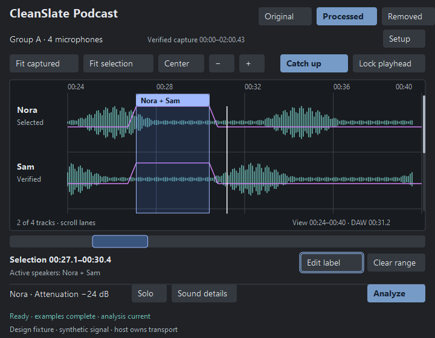
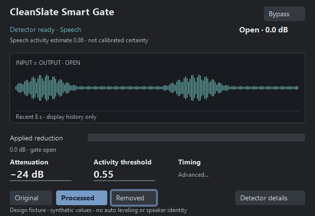

# CleanSlate plugin UI contract

Design-only delivery for [ticket 90](../../.scratch/offline-supervised-editor/issues/90-plugin-ui-design-contract.md), 2026-10-26. No plugin implementation, host acceptance or measured presentation improvement is claimed. [Product boundaries](../plugin-products.md) and the accepted migration specification remain authoritative. [Reference ledger](../research/plugin-reference-ledger.md) distinguishes static vendor evidence from runtime unknowns.

## Direction and review artifacts

### Owner quality target — 2026-10-27

The owner explicitly wants FabFilter/sonible-level visual craft, animation and performance for both products. Treat that as an implementation quality target: purposeful, fluid signal displays; clear readable hierarchy; carefully drawn controls; stable numeric feedback; responsive interaction and low idle cost. Continue the established CleanSlate charcoal/teal/purple/blue roles with original artwork and task-specific composition. This expands the earlier layout work; it does not claim measured vendor equivalence or select a new framework.

The [interactive visual study](plugin-ui/visual-study.html), [frozen renders and verification notes](plugin-ui/visual-study.md) provide a concrete refinement target. Compact studies retain 640×440 Gate / 720×560 Podcast. Full studies are 1000×620 / 1000×680; adapt to actual negotiated host dimensions without shrinking labels or dropping controls. These generated examples are not shipping editor captures, final DSP settings or native interaction/performance evidence. The study's full-SVG browser redraw is illustrative, not a proposed native rendering architecture.

Implement through [94 — Gate](../../.scratch/offline-supervised-editor/issues/94-smart-gate-interface.md) and [103 — Podcast](../../.scratch/offline-supervised-editor/issues/103-podcast-visual-motion-polish.md). Preserve 96's workflow/state/safety fixes before Podcast refinement. Use the existing native editor seam first; reconsider tooling only for a demonstrated limitation with an embedding/lifecycle/measurement proof.

Native active graphics should target fluid 60 Hz presentation where the host supports it, with meters/confidence independently rate-limited (initial target at most 30 updates/s). These are goals to measure, not current guarantees. Audio and automation changes remain immediate; 110 ms control-indicator easing and 250 ms Catch up follow the motion/interruption table below. Settled controls stop their own animation requests; hidden/closed editors stop nonessential work. Reduced motion keeps values and states visible while removing continuous decorative movement. Do not use aesthetic smoothing to change DSP gain timing, resample recorded waveforms or conceal missed worker deadlines.

Acceptance must compare the same pre/post fixture, build profile and native host: idle/playback/drag/follow/resize, multiple instances, cold/warm caches, CPU geometry/tessellation and allocations, private memory/working set and presentation timing where observable. Record p50/p95/p99, late frames, sample window and observer overhead. Require bounded visible geometry, stable memory after warm-up and no GUI locks/allocations on the audio callback. Do not infer presented FPS or vendor-equivalent performance from a screenshot, toolkit name, browser preview or CPU drawing span.

Operate mode: help a person make a safe sound decision while the host plays. Inherit CleanSlate's muted charcoal, readable sans-serif labels, teal source signal, purple gain and restrained blue actions. The first viewport shows the actual task: Podcast source-time examples and analysis readiness; Gate activity evidence and applied reduction. The distinguishing interaction is stable source-time selection that survives navigation, not an animated skin. Host transport stays in the host.

These are original code-native fixtures with synthetic signal and illustrative values. They propose layout/control relationships, not recovered vendor artwork or screenshots of a running plugin. No vendor asset, font file or dependency was copied. SVG is the editable truth; PNGs are deterministic review derivatives. [Generator](plugin-ui/generate.mjs), [renderer](plugin-ui/render.ps1), [logical dimensions](plugin-ui/dimensions.json) and [DPI render manifest](plugin-ui/renders/manifest.json) are included.

**PNG typography limitation, confirmed by follow-up review:** the retained PNGs do not faithfully render the specified 600-weight sans-serif text: headings/selected labels visibly fall back to a serif face. The canonical SVGs retain `font-family="Segoe UI"` with weights 400/600 and are the typography authority. Use PNGs for layout/geometry review only. Exact native font/DPI behavior remains unqualified; the earlier inline review missed this weight-specific fallback.

| Product | Compact / proposed minimum logical size | Full logical size |
| --- | --- | --- |
| Podcast | [720 × 560 SVG](plugin-ui/podcast-compact.svg) · [100% PNG](plugin-ui/renders/podcast-compact-100.png) · [150%](plugin-ui/renders/podcast-compact-150.png) · [200%](plugin-ui/renders/podcast-compact-200.png) | [1000 × 680 SVG](plugin-ui/podcast-full.svg) · [100% PNG](plugin-ui/renders/podcast-full-100.png) · [150%](plugin-ui/renders/podcast-full-150.png) · [200%](plugin-ui/renders/podcast-full-200.png) |
| Smart Gate | [640 × 440 SVG](plugin-ui/gate-compact.svg) · [100% PNG](plugin-ui/renders/gate-compact-100.png) · [150%](plugin-ui/renders/gate-compact-150.png) · [200%](plugin-ui/renders/gate-compact-200.png) | [800 × 560 SVG](plugin-ui/gate-full.svg) · [100% PNG](plugin-ui/renders/gate-full-100.png) · [150%](plugin-ui/renders/gate-full-150.png) · [200%](plugin-ui/renders/gate-full-200.png) |





Podcast dimensions reuse the actual 84 capture sizes. Gate sizes are new design targets, not currently supported native editor dimensions. DPI means logical geometry ×1/1.5/2; it does not mean shrinking controls into a smaller host window. A host that cannot provide the minimum physical area must allow scrolling or opening a larger editor, not silently shrink text. Below the proposed minimum is outside this layout contract; host negotiation remains implementation acceptance.

Evidence inspected: `%LOCALAPPDATA%/CleanSlate/SessionUiCaptures-0.0.6/session-workspace{,-compact}.png`, actual 1000×680 and 720×560 CPU renders, and [84's final installed-build receipt](../research/plugin-navigation-delivery-2026-10-25.md). Those captures show eight lanes consuming almost the full height; labeling and sound controls fall below the visible viewport at compact size. This design reserves action/readiness space and scrolls lanes independently. It does not call the old synthetic flat peaks representative audio.

The Impeccable context launcher ran once with this document as target. It found no root PRODUCT.md/DESIGN.md. The preserved plugin `plugins/fl-probe/PRODUCT.md` in the Podcast worktree, actual captures, `src/appearance.rs`, `src/app.rs` and preserved `editor.rs`/`session_editor.rs` supplied incumbent truth. DESIGN.md is absent in the primary and both named product workspaces; no replacement visual system was invented. Graph-first symbol discovery returned `Transport closed`; narrow named-file reads were used, without rebuilding the graph. Impeccable/Refactoring UI craft review is inline under this sequential task's no-new-agent boundary. No root product/design files or launcher configuration were changed.

## Shared tokens and controls

Use existing roles, not a second palette. Source: desktop `src/appearance.rs::Appearance::colors` and plugin `plugins/fl-probe/src/editor.rs::style` in the preserved product workspaces. The desktop default font is Segoe UI (`src/app.rs`); the plugin currently asks egui for its proportional family. The mockups render installed Segoe UI without redistributing it. Exact native plugin font matching remains a check; keep the existing proportional role unless the product deliberately adopts the desktop family with a valid cross-platform fallback.

| Role | Current Dark value / use |
| --- | --- |
| Surface / panel / plot | `#202226` / `#292D33` / existing plugin plot `#181B1F` |
| Primary / supporting text | `#E4E7EB` / `#ADB5C0`; supporting text remains readable |
| Control / hover / panel separator | `#343940` / `#414750` / `#3D434C` |
| Action / action text | `#779BC7` / `#152233`; reserve filled emphasis for selected audition/follow or primary Analyze |
| Focus | `#9AC5FF`; 2 logical px outline, offset 2; independent of selection |
| Source / gain | `#6FBEB7` / `#D282F5`; source and actual gain are separate marks |
| Selection / selected label | Existing selection `(70,120,220,0.18)` / `#A0B9FF`; dark label text `#101824` |
| Applied attenuation / error | Existing attenuation `(220,65,65,0.24)` behind signal; error `#DB8B8B` with reason/recovery text |
| Status | Success `#76B99A`, warning `#D8B579`; never communicate ready, stale or error only by color |

Body/button 14 logical px; supporting/time labels 12; product heading 20 semibold; editable main sound values 20 semibold. Use tabular numerals for times/values where the existing font supports them; do not fake alignment with spaces. Preserve plugin item spacing 8 horizontal / 7 vertical and button padding 12×7. Layout adds 16 outer margin, 24 between task groups, 4–8 within groups; 4 px control corner radius and thin separators. Mockups use 30 px button height; actual labels must fit without reducing type. Fewer toolbar controls can move to the existing named context menu, with a visible More action if space requires it; primary actions stay visible.

Generator assertions verify normal text/control/action/supporting contrasts ≥4.5:1 for the used pairs, control bounds/non-overlap and bounded file size. This is not an accessibility audit of the native renderer. Disabled controls retain legible labels and an accessible reason; distinguish disabled styling through fill/state as well as lower emphasis. Focus, selection, active-label and gain are separate roles. Existing Light tokens remain authoritative if appearance is exposed later; this scoped plugin contract/capture matrix is Dark, matching current plugin support. No unimplemented Light plugin mode is claimed.

## Podcast layout and behavior

P1 **Persistent source-time workspace.** Top row contains product identity and Original/Processed/Removed. Second row shows group/member scope, verified coverage and Setup. Setup is collapsed while a blocker remains visible. Do not add host Play/Stop, DAW seeks, export actions or a false full-file waveform. Captured source time, gaps and verified interval are distinct from the current visible range. Loop/seek cannot concatenate unrelated audio or clear valid history implicitly.

P2 **Navigation before decoration.** The timeline toolbar keeps Fit captured, Fit selection, Center and zoom controls, then Catch up/Lock. Follow modes are mutually exclusive with Off reachable by deselecting the active mode/context menu. The navigator shows whole captured history and its viewport. Ruler, labels, waveforms, applied gain and playhead share one source-time transform. Retain source-time width at boundaries; clamp without collapsing the view. Navigation never changes audio, labels, examples, gain or host transport.

P3 **Bounded lane viewport.** Full fixture shows four lanes; compact shows two of four with a lane scrollbar. Up to eight members remain accessible without shrinking below a readable 64 logical px lane. Resize changes visible lane count/height; it cannot scroll Analyze/audition/readiness out of reach. Selected track stays visible after a deliberate selection; background peer updates do not reorder the user's focus. Long member names truncate with a full-name tooltip and stable ID in Setup; duplicate names do not become identity.

P4 **Examples close to the selected range.** A stable area below the navigator states range and active-speaker set, with Edit label/Clear range. Primary drag selects; ordinary click can focus the range region but never moves DAW transport. The planned pointer-adjacent speaker multiselect adopts the desktop labeling model within the editor bounds; the current plugin has separate label/overlap controls, so this popup is a planned consolidation. No speakers = Room, one = solo, several = overlap. Validate coverage/bounds/source identities before saving. Contradictory examples require explicit replacement; no newest-label-wins rule. Saved examples stay visible/editable; Escape cancels the current draft only. Fast press/move/release between redraws must commit one complete gesture.

P5 **Explicit Analyze and truthful readiness.** Bottom row groups selected-track sound, Solo and Sound details; Analyze remains reachable. Last row shows current stage/elapsed or current/stale/blocked status with the next action. Missing speaker/room examples identify the member and usable-duration correction; no fake percentage or predicted completion time. Analysis requires common compatible captured evidence. Preserve the last valid display while busy, mark stale results and do not represent old gain as current.

P6 **Selected-track sound.** The shown Nora attenuation is a planned per-track control, not the current shared-only setting relabeled. Distinguish Default for all versus Override this track inside Sound details. Display which scope an edit changes; do not silently write another instance's host parameters. Proposed finite attenuation range reuses desktop −120..0 dB plus explicit Mute; validate against the maintained sound domain and current envelope. Gain-only edits should reuse compatible evidence and one evaluator for drawing/audition/output; labels require Analyze. Current Session shared sound still requires Analyze, so immediate per-track edits/cache reuse are an implementation gap owned by Podcast acceptance (96/81/82), not delivered by this document.

P7 **Audition and recovery.** Original/Processed/Removed describes audio audition, not waveform visibility. Future source/processed overlays must use separate named controls. Solo is monitoring-only and must not change final processing. Loss of compatible evidence preserves original audio and shows the reason; never keep a green Ready label over bypassed/stale sound. Setup/reconnect/reset controls explain exactly what history/labels are retained; destructive cache/history clear needs a scoped confirmation and must not silently replace sources.

## Desktop parity, current evidence and planned gaps

Current means preserved 0.0.6 installed `94cf0dc682447677e1d942397dfc8aea929c9fe697a5a0035127968dace54aaa` and ticket 84's exact receipt; separate product identities remain later work. A button/event regression is not native gesture qualification. Plugin and desktop own separate action dispatch because they use separate renderers; reuse the documented action contract's stable identity/availability/hint pattern rather than invoking Iced messages inside egui.

| Control | Current plugin / desktop relationship | Design contract and remaining acceptance |
| --- | --- | --- |
| Wheel / Ctrl-wheel / pinch | Pointer-anchored zoom implemented; wheel observed in FL; Ctrl/pinch event evidence only | Retain local source-time anchor, focus ownership and bounded zoom. Physical pinch/Ctrl forwarding remains unqualified. |
| Shift/horizontal wheel, middle drag | Pan implemented; horizontal wheel observed; held middle/modifier injection unsupported | Retain selection, one gesture owner and restore/reanchor follow intent on release. Native held-middle check remains open. |
| Alt-drag range / fit selection | Event-tested range zoom; focused F/quick drag observed; desktop shortcuts differ | Temporary zoom range must not overwrite examples/selection. Native Alt drag remains unqualified. |
| Fit / ± / earlier/later / Center | One local Navigation dispatch backs buttons/keyboard/context menu; Fit captured Home, selection F, Minus/Plus, Left/Right, Center C | Keep current bindings discoverable; desktop F/Shift+F semantics are not claimed identical. Center moves viewport, never seeks host or silently toggles follow. |
| Navigator | Captured-time navigator implemented; complete native drag/resize parity not established | Drag body pans, handles resize view with same bounds, keyboard alternative through named navigation actions. Distinguish coverage gaps from blank audio. |
| Catch up / Lock | Functional FL follow/loops observed; exact desktop 250 ms eased Catch up not implemented | Adopt desktop intent/interruption contract below as planned parity; do not describe current plugin jumps as measured 250 ms easing. |
| Focus / shortcuts | Focused local navigation implemented; plugin shortcut customization absent | Logical focus order, popup/text ownership and adjustable-plugin-action model are specified below. Host forwarding needs qualification. Never capture global transport keys. |
| Examples / gain / overlays | Example editing exists; desktop gain-point editing, protected-edit workflow and original/processed overlays absent | Carry labels/source binding now; do not show draggable gain handles or desktop export/file actions until implemented. Mockup purple effective gain is planned visualization, not evidence that base 84 draws it. |
| Shared settings / member scope | Current sound settings are shared and require Analyze; host metadata/automation limitations remain | Per-track override, independent action availability and automation-gesture routing need explicit product implementation/tests. Design is not current host-automation parity. |

## Smart Gate layout and behavior

G1 **One signal, no capture workflow.** Header provides product identity and Bypass; no multitrack membership, room/solo/overlap labels, capture-ready checklist, Analyze or automatic leveling. The short recent display is a bounded monitor, not a source-time editing/capture promise.

G2 **Confidence versus gain.** Header labels the detector readiness and a speech activity estimate (0..1), explicitly uncalibrated unless detector 92 establishes calibration. Do not title it Accuracy or percent certainty. Separate Open/Attenuated/Bypassed/Unavailable text and applied reduction in dB describe the actual controller/output. “Open” can coexist with low activity during hold; “Attenuated” can coexist with increasing activity during opening. They must not be forced into a single light. Silence/no input is distinct from detector error.

G3 **Signal and reduction.** Main monitor compares input/output and a separately labeled reduction meter. When open at unity the two traces coincide, so the fixture explicitly says Input = Output. At attenuation, distinguish original dim trace and processed solid trace with text/line style. A displayed signal is not proof of sample-exact waveform timing. No expensive spectrogram or copied vendor skin is needed.

G4 **Bounded sound controls.** Main row shows attenuation and activity threshold, plus Timing. Compact uses Advanced to reveal timing in a keyboard-accessible anchored panel; full exposes concise attack/hold/release. Every field has drag/arrow adjustment, typed value, reset and accessible units. Reject NaN/infinity and out-of-domain values before publication. Candidate design domain: attenuation −120..0 dB plus explicit Mute; activity 0..1. Timing exposes only ranges actually supported/qualified by 93. Illustrative 5/150/180 ms values are fixtures, not accepted shipping defaults or proof of lookahead/latency. Keep DSP transition policy in 93; the display never smooths or alters audio itself.

G5 **Audition and detector details.** Original/Processed/Removed are persistently reachable; bypass is explicit and preserves settings. Detector details provides version/readiness/error and normal reset/retry only if supported by the selected implementation. No fabricated voice enrollment/profile-training flow: speech category detection cannot prove personal speaker identity.

G6 **Readiness and fallback.** Waiting for input, loading detector, ready, bypassed and error are explicit. A detector failure cannot silently select a different model or level gate. Apply the product's conservative validated fallback (original audio while unavailable) and expose recovery; meter/GUI loss must not leave an uncontrolled attenuation state. Save/reopen persists validated sound values, not mockup signal history or made-up readiness. Detector 92/DSP 93 determine actual initialization/cancellation/state boundaries.

## State, focus, keyboard and tooltips

| State / event | Podcast | Gate / shared focus rule |
| --- | --- | --- |
| Empty | “Play in your DAW to capture input”; identify connected/missing members; Analyze unavailable with reason | “Waiting for input”; no invented signal, activity or reduction. Bypass/values still reachable. |
| Loading / reconnecting | Keep last snapshot and “Reconnecting — original audio”; distinguish restarting from missing setup | “Loading speech detector — original audio”; controls remain stable, no spinning decorative plot. |
| Busy | Actual analysis stage + elapsed time, Cancel and last completed result labeled stale | Initialization/progress only when reported by the detector; no percent/time guess. |
| Ready | Current identity/coverage/examples/result; Processed only uses compatible effective envelope | Detector ready plus separate controller state and applied reduction. |
| Stale | Changed labels/source/settings identify what changed; explicit Analyze/revalidate | A selected detector/configuration change cannot leave an old Ready/activity value silently current. |
| Error / peer loss | Inline reason + Retry/reconnect/select usable range; preserve valid captures/examples; no blanket data clear | Inline detector/processing reason + supported Retry; conservative audio; error text stays until resolved/dismissed without hiding unsafe state. |
| Hover / focus / disabled | Hover changes control fill, focus ring stays separate; unavailable action explains why | Same roles; a disabled focused command cannot dispatch through keyboard/context menu. |
| Drag interrupted | Escape/focus loss cancels draft and releases pointer; completed edit is one undo unit | Value drag cancels/finishes according to the established gesture protocol; send exactly one end-gesture to host. Never leave automation touch active. |

Tab/Shift+Tab walks visible controls in reading order: audition → setup/readiness actions → navigation/follow → lane/range editor → examples → selected-track sound → Analyze/status recovery. Gate: Bypass → supported detector recovery → main values/Timing → audition → Detector details. Tab reaches a lane/plot as one region, not thousands of vertices. Arrow keys then move within that region with a named alternate action. A scrolled-out selected lane is brought into view only on deliberate focus movement. Programmatic progress updates never steal focus.

Space/Enter activates a focused button; text input owns its keys. Escape dismisses the top popup and restores focus to its invoker, cancels an in-progress draft before clearing a committed selection, and does not cancel an unrelated analysis without a focused Cancel action. No shortcut runs through text entry, value editing, shortcut capture or a modal. Existing plugin navigation keys require waveform focus; do not intercept host playback or invent a global shortcut. Planned label popup follows desktop numeric toggles, R clears, S/Enter saves, Escape/outside dismisses; the saved active-speaker set is shown before commit. Binding customization remains planned; stable action ID, one availability check and one handler must drive every invocation.

Tooltips use action names, scope, current units and effective binding, with the existing delayed-hint convention (proposed 500 ms for new plugin hints; verify native behavior). Examples: “Fit selected range · F”, “Center on DAW playhead · C”, “Attenuation for Nora; changes this track only”. Show the same description on keyboard focus without covering the focused value. Essential readiness/error content is always visible, never tooltip-only. Long paths/names disclose on hover/focus and through details; do not expose private source paths by default. Static fixtures demonstrate focus on Edit label/Removed but are not keyboard-operable product controls or a native accessibility validation.

## Motion and interruption

| Motion | Purpose / duration / interruption | Reduced motion |
| --- | --- | --- |
| Dial/value indicator | Reuse desktop's 110 ms indicator interpolation; apply validated audio/control change immediately. Repeated input retargets from current visual position; settlement stops animation redraw. No value drift/lag in typed text. | Snap indicator; same audio/automation values. |
| Podcast Catch up | Planned desktop parity: stationary view until edge, 250 ms eased viewport slide targeting 5% left inset; clamp at source bounds. Stop/seek/zoom/Fit/Center/pan cancels old animation but retains Catch up selection. | Immediate bounded edge reposition; no tween. |
| Lock / manual pan | Middle drag suspends following; release reanchors to actual playhead position; cancellation/focus loss restores prior intent; explicit Center/Unlock wins. Resize respects bounds. | Same behavior; no animated transition. |
| Selection / focus / errors | Immediate feedback on actual press/move/release, focus or readiness change. No animated range endpoints, focus travel or delayed safety message. | Same immediate response. |
| Meters / recent monitor | Coalesce latest snapshots; decay can aid reading but must be separately labeled/qualified. Show actual peak/reduction readouts, not a guessed smoothed state. | Lower display refresh may be offered only if qualified; audio/controller timing unchanged. |
| Panel reveal | Direct open/close with stable anchor, no content jump that moves the active control during a gesture. No entrance choreography, pulsing certainty or decorative loops. | Immediate open/close. |

Reduced-motion preference should use the product/host-supported mechanism with a local override if host delivery is unavailable; that integration is planned, not implemented here. Visual animations are bounded per editor and stop while hidden/settled. Gate attack/hold/release and plugin-reported latency are DSP behavior, wholly independent of all durations in this table. Reference manuals/static code do not establish vendor motion feel or frame pacing.

## Performance contract and reproducible comparison

Use [84's actual captured baseline](../research/plugin-navigation-delivery-2026-10-25.md), not the mockup renderer, as the engineering baseline. Forty frames, eight tracks, 1,000 columns: old waveform CPU drawing+tessellation 4.328 ms/frame and 8,038 shapes; checked observations 1.332–1.880 ms/frame and 46 shapes. Two-hour extraction: old 4.448 ms, observed new 1.842 ms; ten-second extraction 0.179–0.247 ms. These small nonisolated synthetic results are the reference workload, not a new timing gate or guaranteed budget. Current 16 ms editor polling and ≤33 ms capture refresh are scheduling intervals, not presented FPS.

Bound geometry by visible logical columns × visible lanes, with the existing multilevel min/max peaks and batched mesh. Target no more than one min/max pair per visible logical column per lane; at proposed 720 width/two lanes this is ≤1,440 pairs before track-header margins, plus bounded ruler/label/envelope primitives. Clip offscreen lanes/ranges before geometry, cache by exact source/generation/viewport/style/scale, and invalidate all relevant dependencies. Do not rescan two hours per frame or retain unbounded per-frame meshes. DPI increases raster detail, not the amount of source history fetched. Never downsample away a wanted transient or shift source-time label boundaries to meet a drawing budget.

The audio callback cannot acquire a GUI lock, allocate geometry/fonts, do disk I/O or wait for repaint. Audio/capture publishes bounded data; workers validate/index; the GUI takes a bounded snapshot. During lock contention retain last visible snapshot and show age/stale status when meaningful. Discard obsolete generations, coalesce repeated requests, keep cancellation source-aware, and bound queued snapshots to latest accepted/current request. Reuse established product ownership patterns rather than adding an unmeasured renderer/threading framework.

Reproduction plan for 94/96 implementation acceptance:

1. Preserve the tested base executable/source/hash and exact measurement fixture; use a separate synthetic or authorized project copy, same build profile/CPU, 8 tracks, 1,000 columns, 40 frames and the exact extraction ranges above. Log source commit, dirty state, format/host, sample rate/block size, viewport duration, logical/physical size, scale, theme and peak-index/cache warm state. Record cold and warm separately; do not flush shared caches destructively.
2. Re-run the existing named `session_editor.rs` draw+tessellate and peak-query observations through the product build/check entrypoint, under the default heavy guard. Keep raw timing samples, shape/vertex/index counts and p50/p95/p99 over repeated comparable runs. Treat baseline ranges as historical observations; investigate reproducible regressions before choosing more machinery.
3. Add bounded observer spans for event receipt → selection/viewport update, peak query, snapshot age, geometry construction, tessellation and first resulting canvas work. Count allocations/bytes at those specific non-audio boundaries, including cold allocation versus warm reuse; use test instrumentation only. Separately observe callback allocation/deallocation/deadline tails without logging/locking in the callback. A low shape count cannot establish no callback allocation.
4. Native isolated scenarios: idle, capture/playback, fast drag released before redraw, wheel/pinch, middle/Alt drag, range fit, navigator, follow interruption, resize/DPI, gain edits, background analysis, peer loss, close/reopen. Record CPU and sampled working set externally, actual callback underruns and supported presentation timestamps only if available. GUI draw completion/input-event spans are not hardware input-to-photon latency. Report sample window/observer overhead; no presented FPS or vendor comparison without real presentation/vendor evidence.
5. Require exact source-time selection/labels, effective-envelope/audio parity, safe fallback on missing evidence, no audio-thread UI locks, bounded growth, cancellation and stable focus before calling a faster drawing number an improvement. Native keyboard/assistive technology, held-modifier input and hardware DPI changes remain separate acceptance checks.

Low-memory work here used only deterministic rendering under [88's guard](../resource-guard.md): one owned renderer at a time, explicit 0.5 GiB commit cap, 2 GiB available start, 1 GiB reserve, 90 s timeout. Heavy defaults (14/8/6 GiB) remain unchanged. Run reproduction from the repository root with a **new** receipt path:

```powershell
& ./scripts/resource-guard.ps1 -FilePath (Get-Command pwsh).Source `
  -ArgumentList @('-NoProfile','-File',"$PWD/docs/design/plugin-ui/render.ps1", `
    '-OutputDirectory',"$PWD/docs/design/plugin-ui/renders") `
  -TimeoutSeconds 90 `
  -ReceiptPath 'C:/existing-directory/new-render-receipt.json'
```

The renderer invokes installed Node/ImageMagick only. Geometry/control/contrast assertions precede rendering; twelve outputs are checked for exact physical dimensions and hashed. No Cargo/DAW/vendor process is launched. Native widgets, host DPI negotiation, live focus/gestures, motion feel and real DSP cannot be tested by these static PNGs.

## Acceptance mapping and review receipt

| Ticket acceptance | Deliverable / implementation acceptance mapping |
| --- | --- |
| A1 layouts/tokens/states | Four SVG layouts + 12 DPI PNGs; shared tokens, Podcast P1–P7, Gate G1–G6, state/focus/tooltip table. Podcast goes to 96; Gate to 94 after 93. |
| A2 motion/interruption | Motion table explicitly separates visual scheduling from DSP and defines reduced motion. Implementation must test interrupted/retargeted/hidden states. |
| A3 baseline/performance | Exact 84 values, bounded visible geometry/threading contract and five-step reproducible measurement plan; no replacement renderer. |
| A4 minimum/DPI | Both proposed minimums and full sizes rendered at 100/150/200%, inspected as static artifacts. Native scale/focus qualification remains explicit. |
| A5 original/reviewable | Original generator and editable SVGs, synthetic provenance in SVG/PNG, scoped acceptance IDs per layout/behavior; no vendor assets/framework. |

First render review found an 8-digit selection-fill defect and apparent font fallback. Explicit opacity fixes the selection fill; the SVG now uses the single Segoe UI family, but follow-up review confirms that this did not fix the PNG's weight-specific font substitution. All twelve retained outputs were inspected at the two minimum/full sizes and three scales: no missing controls, label overlap or clipped main actions was observed. A final scoped fixture correction aligns the purple unity span with the entire human Nora+Sam label; compact/full Podcast renders were re-inspected at all three scales. Other geometry and Gate source were unchanged. Static fixture curves depict gain levels/relationships, not a recovered or implemented DSP fade equation.

Final guarded receipt: `C:/Users/User/Documents/Codex/Investigations/plugin-ui-contract-90-render-03.json`; completed in 4.22 s, kernel peak owned commit 126.76 MiB, maximum sampled working set 163.57 MiB, minimum available physical 5.84 GiB / commit 5.96 GiB, cleanup verified. First two receipts are retained alongside it; renderer fixes/one safety-related fixture correction explain the additional bounded pass. Generator assertions, twelve dimension/hash checks, local links, SVG parsing and `git diff --check` pass. Impeccable's one mechanical detector run returned `[]`; it is a static check, not a native accessibility result.

Inline finish-review disposition: **ship at static design scope**, with PNG typography partial under the follow-up below. Persistence: inherited source/product context retained; no visual-system replacement. Fidelity: compact/full control reachability, source-time selection, human unity and Gate activity/gain separation match the contract. Ceiling: native control/focus/DPI/host/motion verification remains with 94/96. Material fixes: renderer opacity and illustrative human-unity relationship resolved; exact PNG semibold face remains unresolved. Keep: waveform-first Podcast, focused Gate and honest source/readiness states. Documenter comparison found the existing palette/type roles preserved in the canonical SVGs; no root DESIGN.md or sidecar was created merely to certify these fixtures. This is neither product acceptance nor owner preference approval.

### Focused font-resolution follow-up

The installed ImageMagick catalog maps regular `Segoe-UI` to `C:/Windows/Fonts/segoeui.ttf`, weight 400, and `Segoe-UI-Semibold` to `C:/Windows/Fonts/seguisb.ttf`, weight 600; both files exist. Catalog availability alone did not prove that the SVG reader selected them. Follow-up requested exact-face temporary raster input while preserving canonical SVG semantics. The default SVG delegate explicitly warned that Pango could not load those face identifiers and fell back to generic Sans (receipt `plugin-ui-contract-90-render-04.json`). Selecting built-in MSVG explicitly instead logged only `c:/windows/fonts/arial.ttf`, and its output omitted signal paths/focus text (receipt `plugin-ui-contract-90-render-05.json`). Neither attempt is accepted as a typography correction.

Both guarded jobs cleaned up successfully. Attempt 04 took 4.22 s / 134.50 MiB kernel peak commit; 05 took 10.34 s / 155.94 MiB. Failed explicit-reader images, manifest and attempted renderer are preserved separately at `C:/Users/User/Documents/Codex/Investigations/plugin-ui-contract-90-font-fallback/`; the complete last-good geometry PNGs/manifest and original renderer are retained in the repo. Detailed default-delegate log: `C:/Users/User/AppData/Local/Temp/cleanslate-plugin-ui-fonts-18233a347d26493fa265282c48a9b55e/annotate.log`; explicit-reader log: `C:/Users/User/AppData/Local/Temp/cleanslate-plugin-ui-fonts-3ca13b4286ed4d86a81694f30c97358b/annotate.log`. No renderer installation/configuration or font acquisition was attempted.

Next typography check: render the canonical SVG in the normal supported product/editor renderer and verify regular/semibold face resolution at 100%/200%, preserving source semantics and comparing actual glyphs. Until then the PNGs must not be used as font-fidelity evidence. This bounded tooling limitation does not alter the implementable typography roles or claim that the visual discrepancy was corrected.
