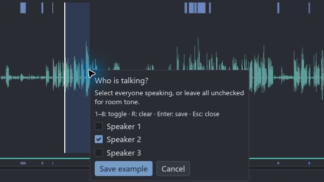
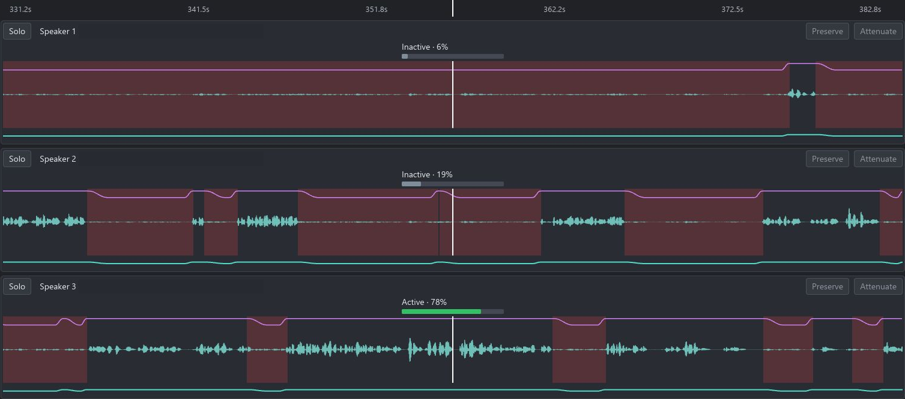
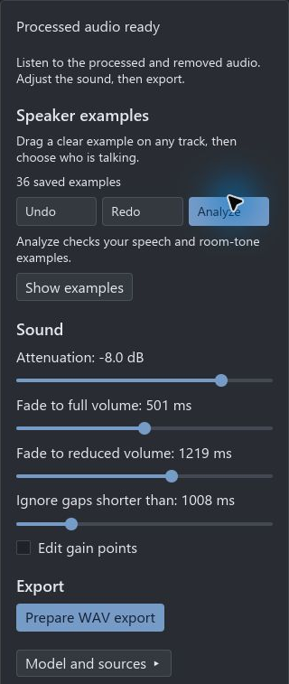
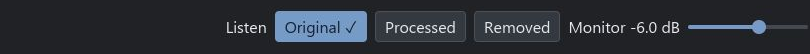

# Supervised editor workflow

## SD cards and working storage

Open recordings directly from an SD card or another readable drive. CleanSlate opens originals for reading only; the card can remain write-protected. Keep it connected until processing finishes. A full local copy of the original recordings is not required.

New projects autosave in local application storage: `%LOCALAPPDATA%/CleanSlate/Projects` on Windows, `~/Library/Application Support/io.github.Today20092.CleanSlate/Projects` on macOS, or `$XDG_DATA_HOME/cleanslate/Projects` (default `~/.local/share/cleanslate/Projects`) on Linux. Sources shows the current project path. Analysis copies and private processed WAVs use the neighboring `Work` directory, independently of the originals and export destination. These files use local disk space. Projects opened from outside local application storage, or marked read-only, open as new local editing copies; the old project remains unchanged. Reopen the displayed local project to continue those edits.

In Export, choose any writable parent location, including Downloads or an SD card. The dialog shows a new `CleanSlate export` folder inside that location, adding a number when needed. Existing files and original recordings are never replaced. Output is prepared privately on the destination volume, verified and flushed before the completed folder is published. A locked card can be an input, but cannot receive exports; choose a computer folder instead.

Recognized transient read/seek errors receive at most two fresh-handle retries per file, at the last confirmed byte position. A reconnect with changed metadata is rejected; full source fingerprints and render provenance are still checked before publication. Unreadable samples are never skipped or replaced with silence. Permanent failures identify the operation, file and underlying cause. Reconnect the original media and retry, relink if its location changed, or choose another export destination. Edits and accepted output remain available after failure. Permission, corruption and disk-space errors do not trigger automatic write retries.

The Iced workspace combines validated sources, 16 kHz analysis copies, human references, acoustic evidence, independent per-track ownership models and shared effective gain envelopes. Analysis uses the embedded Silero speech detector and learns track ownership from your labels across the whole recording. No model download or separate runtime setup is required. See [how ownership and bleed work](ownership-explained.md) for the full explanation and diagram.

Import synchronized mono tracks, declare supplied synchronization when appropriate, and listen in Original mode to find solo speech and room tone. Click to seek; Space plays/stops. Drag across a waveform to open the speaker multiselect immediately. Select nobody for room tone, one person for solo speech, or several for overlap, then save the label. Supply a solo reference for each speaker and a room reference. Additional examples across the recording can improve calibration. Analyze validates reference usability; merely saving a label does not establish that it is usable. Speaker numbers are stable identities, not inferred names.

Open Speaker examples to browse saved clips with readable times. Play auditions a clip; Show on timeline selects and zooms to it. Click a clip's strip on the waveform and drag its left or right handle to adjust the boundaries. Release saves one undoable change; Escape cancels the drag. Right-click the clip to change its speakers or delete it. Edits preserve exact internal timing, and conflicting labels require explicit replacement. Analyze again after changing examples.

## Multichannel WAV import

Import tracks and file drops also accept multichannel WAV/BWF recordings. Choose speaker channels shows the channels initially selected; deselect recorder mixes or unused inputs and edit the names before importing. Names come from iXML interleave metadata when present, with Channel N as the fallback. Each selected channel becomes an editable track backed by the original WAV, with its native sample rate, frame count and timing intact. Import does not create separate source WAVs.

Channels in one WAV are internally synchronized. Separate mono files may be included in the same project, subject to the usual physical-duration and timing checks. Missing timing between files still requires a supplied-synchronization declaration. The project accepts at most eight speaker tracks. Rename in a track header changes its saved name; Analyze again before final rendering after a rename. Export can deliver separate processed mono WAVs or one compatible multichannel WAV, preserving BEXT timing where present. See [export settings](#export-settings).

## Analysis and editing

Drag a range to open **Who is talking?** Select everyone you hear: one person for solo speech, several for overlap, or nobody for room tone. The selected microphone does not decide the label. This capture shows an unsaved selection; the checked speaker is an example of the control, not a verified annotation. Enter saves; Escape closes without saving.

Compare the [solo, overlap and room-tone examples](ownership-explained.md#1-you-supply-examples) before labeling a range.

Analyze is explicit. Several label changes can be collected before one job. Progress identifies the current stage and elapsed time. Preparation, acoustic ownership fitting and temporal decisions use your examples to estimate ownership throughout the timeline. Cancellation, source changes or obsolete label generations prevent installation. Completed fixed evidence can be reused. A failed project save cannot advance the accepted effective-envelope cache.

The previous preview remains visible when stale. Gain-only changes compose immediately and do not rerun Silero, acoustic fitting or ownership training. A gain edit made during Analyze is composed from the latest project when the result installs. The displayed estimates are inspectable model probabilities; they do not promise calibrated certainty. The [model recipe](supervised-ownership-models.md) and [temporal policy](temporal-ownership.md) describe the current acoustic branch.

The waveform displays source peaks and conservative processed bounds. In the compact overview, blue marks human references, gray marks automatic gain, teal marks effective gain, pink marks manual points, and gold marks unity protection. Overview pixels summarize their entire time interval, so a brief owned or uncertain region remains visible. Gain drawing includes per-pixel extrema, including excursions shorter than one pixel.

In the current development layout, the main waveform uses a purple gain curve and muted red backgrounds wherever applied gain is below full volume. A shaded span means reduced volume, not proof that nobody is speaking. The overview retains compact gain and example markers.

The curve shows when volume falls and returns to full level. At the white playhead, each track also shows an **Active / Inactive** estimate and a percentage. These are model estimates of speaker activity, not volume meters or a guarantee of correct detection. Compare the waveform, gain curve and listening result when deciding whether to correct a region. Recording filenames are redacted.

**Attenuation** sets the reduced level. The two fade controls set the maximum transition durations. **Ignore gaps shorter than** keeps brief automatic gaps open. On the `codex/fabfilter-controls` review branch these continuous settings use a large attenuation dial and three smaller timing dials, with precise editable numeric values; the screenshot above predates that refinement. Drag or turn the wheel over a dial, hold Shift for fine adjustment, double-click to type, and Ctrl-click (Command-click on macOS) to reset. These are the captured session's settings, not recommended defaults. Enable **Edit gain points** for manual corrections, or select a range and use **Preserve** to keep it at full volume.

See the [fade-and-gap plots](effective-envelopes.md) for the difference between shortening fades to fit a gap and keeping a short automatic gap at full volume.

Switch the envelope tool on to drag manual points horizontally for fade duration or vertically for gain. A drag uses a transient draft; release commits one undo command and cancellation restores the saved curve and markers. Arrow keys move a selected point, Delete removes its whole override, and Ctrl+Z/Ctrl+Y undo/redo. Text inputs retain their captured keys. Preserve and Attenuate create region edits. Conflicts require the explicit **Replace entire overlapping overrides and protections** option; it removes the conflicting records as whole records, including the other bindings of a global protection.

Open/close settings specify finite S-shaped fade durations with exact endpoints and zero endpoint slope and curvature. Shared evaluation keeps automatic fades outside preserved speech. Manual gain remains authoritative until removed and retains linear interpolation. All source-time curves stay sparse; native-rate playback and rendering use the same evaluator. Transparent attenuation remains a listening requirement, not a guarantee from the curve alone.

Review the waveform and audition directly. There is no uncertainty review queue. Use labels to improve detection or Preserve/Attenuate and protection to correct gain. Ignore gaps shorter than bridges brief automatic attenuation gaps between speech spans; it does not erase explicit room-tone labels. Original works before analysis. When a preview exists, Original, Processed and Removed preserve transport and seek context while using the current effective envelopes.

Compare **Original** with **Processed**, then listen to **Removed** for wanted speech that should remain. **Monitor** changes listening level only. Track-header **Solo** buttons can monitor several tracks together; they do not change exported gain.

The control-refinement branch uses a flat, stable-width listening selector with a persistent selected accent and keyboard focus indication. Its compact Lock, Center and Meters toolbar retains short labels and command tooltips. While Lock is active, middle-drag pans freely without disabling it; release anchors the then-current playhead position on screen. A click without movement preserves the prior anchor, cancellation restores it, and explicit Unlock/Center takes precedence. Playback time, labels, selection, edits and saved project state are unchanged by navigation.

Save project persists labels, gain overrides, protections, review states and recipe identities. Opening a project validates sources; Analyze reconstructs its preview using reusable fixed evidence.

Final rendering applies the accepted effective envelopes at each source's native sample rate. Export verifies that accepted render's report, WAV hashes, source identities and saved project identity before encoding the selected delivery. Monitoring gain, Solo controls and comparison mode never enter exported audio. Label/model/source changes require current analysis; gain edits require a fresh render without repeating inference. Both final render and delivery can be cancelled. Incomplete or obsolete private attempts never replace prior deliverables. A published attempt that cannot be accepted remains beside the project as recovery material; deleting it is an explicit file operation.

## Export settings

Open Export after checking the current result. The dialog lists track/channel order and original sample rates, offers payload-size estimates, and requires a new or empty destination folder.

| Setting | Behavior |
| --- | --- |
| Separate mono WAV files | One processed file per track, keeping each native sample rate and timing. This is the default layout. |
| One WAV with separate channels | One processed multichannel file in the displayed track order. It keeps channels separate rather than summing them. |
| Preserve source encoding | The default encoding. Supported WAV encodings are retained; non-WAV and float64 sources use float32. |
| 24-bit PCM | A common integer encoding for delivery. |
| 32-bit float | Floating-point delivery without integer quantization. |

Multichannel output requires matching sample rates, frame counts and timing, compatible BWF metadata, and a common output encoding. For mixed source encodings, select PCM24 or float32 explicitly when preservation cannot produce a common format. Mixed native rates remain separate files; Export does not resample, trim or pad them to fit one WAV.

The encoding preference is saved per project. Layout and destination are dialog choices. Integer delivery applies final dither once and preserves exact silence. Integer overload blocks export; choose float32 or deliberately correct gain instead of silently clipping. Oversized RIFF delivery is rejected. Payload estimates do not include every header byte. See [the export contract](../src/export_settings.rs) and [delivery validation](../src/export.rs) for exact limits.

## Historical validation and remaining checks

Earlier controlled tests exercised complete composition, label correction and batching, the former review navigation, latest gain edits, drag/undo, comparison, save/reload, cancellation, obsolete generations, changed runtime and failed saves. Synthetic references/history are development fixtures, not owner truth or release-quality evidence. App checks cover fresh Original playback, draft markers and captured-key isolation. See [owner verification](owner-verification.md) and [GUI development](gui-development.md) for newer evidence; these records do not establish release acceptance.

Two-hour mixed-rate drawing tests use the production visible kernels. On the development computer, 100 gain/ownership queries plus navigation/hit checks took 108 ms total; 300 waveform peak queries with navigation took 1.44 ms. These measurements exclude neural work, cache construction, window compositing and physical audio-device latency. The queries are bounded by visible pixel/bucket counts rather than all source samples.

An earlier offline `model-check --verify-only` check passed against the former pinned model and native runtime. That experiment has been removed; the result does not verify the current acoustic-only package. Owner listening and physical window verification remain separate release gates.

The authorized three-track recording has an ignored ready-to-open project at `test-audio/261005-supervised.cleanslate` in the primary checkout. It uses Speaker 1–3 and declared supplied synchronization. It deliberately has no solo or room references; the owner chooses those while listening in Original.
