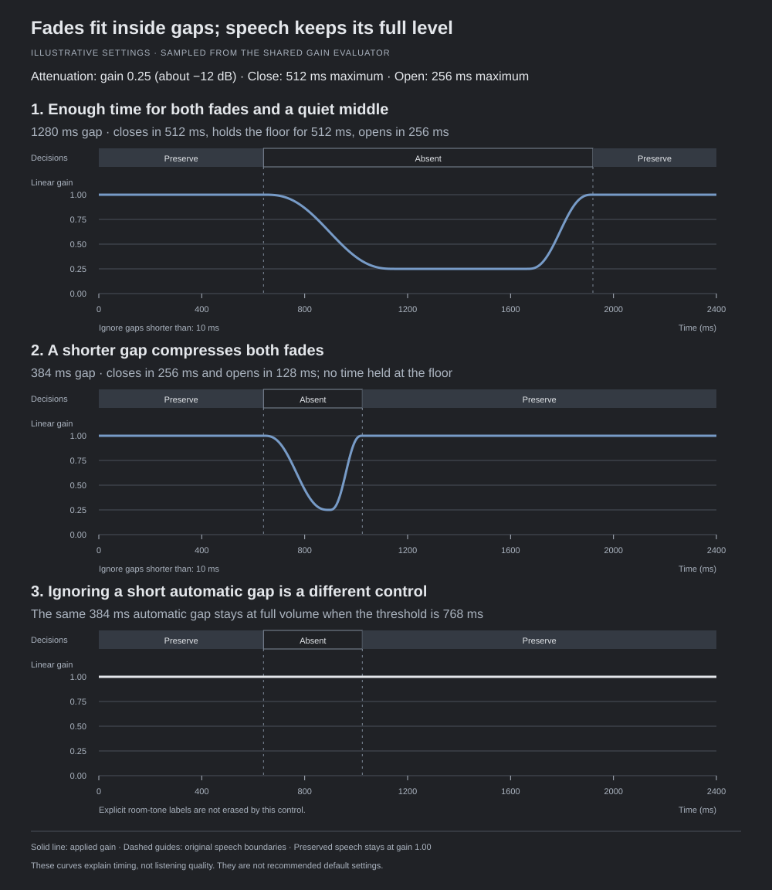

# Effective envelopes

Recipe `finite-smootherstep5-live-bounded-gap-source-time-halfopen-linear-manual-v4` composes sparse automatic curves with source-bound manual edits and unity protections. The recipe identifies the new curve in automatic/effective cache keys and project sound identity. Existing exponential renders become stale and require a fresh render; source audio and saved manual edits remain intact. `GainEnvelope` supplies the same time evaluator to waveform display, audition and native rendering. Native sample access, sequential access and interval bounds dispatch through this evaluator; no native-rate gain array is allocated for the new pipeline.

Automatic opening and closing use positive, explicit durations and quintic S-shaped interpolation with exact endpoints and zero endpoint slope and curvature. Owned and uncertain regions, including overlap, stay at exactly unity unless deliberately edited. Their edges round outward on each native source grid. Transitions fit outside those regions. Requested durations are maxima; both fades fit proportionally inside shorter absent gaps, meeting at the requested attenuation without shortening speech. The persisted minimum-gap control bridges only brief bounded automatic gaps and never explicit human absence. Fade settings are explicit evaluator inputs. The smoother curve reduces abrupt transition artifacts but cannot guarantee inaudibility or prevent the audible effect of removing background/bleed; listening approval remains required.

These illustrative settings use a 0.25 linear gain floor, about −12 dB, with requested closing/opening times of 512/256 ms. In the 1280 ms gap, both fades fit with a plateau between them. In the 384 ms gap, they shorten to 256/128 ms and meet at the floor. Setting **Ignore gaps shorter than** to 768 ms instead keeps that automatic gap at full volume. Explicit room-tone labels are not erased. These are teaching settings, not recommended defaults or evidence of listening quality.

[Text equivalent and example settings](diagrams/fades-and-gaps.html). The curves were sampled from the shared gain evaluator and checked at their endpoints and intermediate points.

Inside each automatic fade, normalized time is `u = (time - start) / (end - start)`. The shape is `s = 6u^5 - 15u^4 + 10u^3`, clamped to `[0, 1]` against floating-point roundoff. Gain is `from + (to - from) * s`; at or outside the endpoints the evaluator returns the exact endpoint gain. The same shape handles opening and closing. At the midpoint, gain is halfway between the two targets; at one quarter of the duration, it has moved about 10.35% of the gain difference.

Processed audio is `source sample * effective gain`, evaluated at each sample's source-aware time. Removed audio uses the complementary gain `1 - effective gain`; playback-only monitoring headroom does not enter exports. Gains are bounded from zero to unity, so automatic attenuation never boosts the source. Constant gain preserves the waveform's shape; time-varying gain can still produce audible modulation, especially with short fades or large reductions.

Manual points use the persisted `Linear` interpolation variant and bounded finite gains from zero to one. Each edit owns its half-open interval `[first point, final point)`. The final point specifies its left limit; at that time, a touching edit, protection or current automatic envelope takes over. Restoration may intentionally jump. Conflicting edits and protections are rejected until the caller explicitly replaces the conflicting records. A global protection covers only the source bindings captured when it was created; adding a track does not extend it.

Drag drafts can be previewed without changing the saved project or accepted envelope cache. Committing a draft changes both manual edits and protections in one atomic, undoable command. Undo and redo are session-local; active edits, interpolation and protection bindings persist across reload. Failed saves retain the previous file, project and undo state. Removing an override exposes the current automatic result. Reanalysis never removes manual edits.

Manual updates reuse the sparse automatic layer and do not run inference, acoustic fitting, classifier training or temporal optimization. Interactive checks use loaded source stamps and binding identity; analysis and final delivery retain their strong fingerprint checks. A changed source cannot use an old automatic result or old manual binding. Explicit source review/rebinding and fresh analysis are required. Label changes can retain a visibly stale preview, represented by `analysis_current = false`.

The evaluator is connected to the current acoustic editor, native-rate rendering and current-result export through the completed integration work in tickets 12/13. Controlled tests establish numeric behavior, not real-recording detection quality or listening approval; those remain ticket 14 work. See the [editor workflow](editor-workflow.md) and [current temporal policy](temporal-ownership.md).
