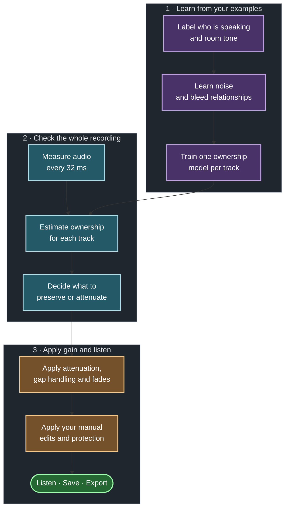

# How CleanSlate reduces microphone bleed

CleanSlate works with synchronized microphone tracks, one for each speaker. You label a few examples. The tool learns from those examples, checks the whole recording, and reduces gain when a microphone's assigned person is not speaking.

Your labels teach detection. Manual gain edits let you correct the sound directly.

## What does ownership mean?

Ownership means that a track's assigned person is speaking into their own microphone.

Suppose only Speaker 3 is talking. Their voice reaches all three microphones:

| Track | What it records | Desired result |
| --- | --- | --- |
| Speaker 1's microphone | Speaker 3 as bleed | Reduce gain |
| Speaker 2's microphone | Speaker 3 as bleed | Reduce gain |
| Speaker 3's microphone | Speaker 3's direct speech | Keep gain unchanged |

All three tracks can contain speech. Only Track 3 owns the speech in this example. If two people talk at once, both of their tracks can own speech.

## The process



### 1. You supply examples

Drag across a clear section and select everyone speaking.

- One selected person means solo speech.
- Several selected people mean overlap.
- Nobody selected means room tone, with no person speaking.

Supply a solo example for each speaker and a room-tone example. A few clear sections across the podcast can be enough to start. Add more if the result needs correction.

A "Speaker 3 only" label teaches Track 3 what its own speech looks like. It teaches Tracks 1 and 2 what another person's voice sounds like in their microphones.

Labels also specify the correct speaker set inside those sections. They do not limit processing to those sections. The tool checks unlabeled sections too.

### 2. The tool learns the bleed relationships

You do not need a separate bleed label.

In the Speaker 3 example, the tool compares Track 3 with Tracks 1 and 2. It estimates how Speaker 3's sound leaks into each other microphone, including its expected level.

The reverse relationship can be different. Speaker 1 leaking into microphone 3 needs its own estimate. Distance, microphone direction, gain and room acoustics affect these relationships.

Room-tone labels teach the background-noise level.

### 3. The tool measures each short section

Every 32 milliseconds, the tool checks:

- Does this track contain speech-like sound?
- How far is its level above room noise?
- How loud is it compared with the other microphones?
- How much of its sound can the other microphones explain as bleed?
- Is there additional sound above the expected bleed, and how reliable is that estimate?

The embedded Silero VAD supplies the speech-activity measurement, with no separate model download or runtime setup. It can detect bleed as speech, so that measurement alone cannot identify the track's own speaker.

### 4. A small model combines those measurements

CleanSlate trains one logistic regression model for each track.

A **weight** sets how much a measurement affects the model's answer. Training adjusts the weights to make its answers match your labeled examples.

For example, the model can learn that a signal explained well by another microphone tends to be bleed. It can also learn that additional sound on this microphone helps indicate its own speaker. The actual combination comes from your examples.

The model produces an **ownership estimate** between 0 and 1:

| Estimate | Meaning |
| --- | --- |
| Near 0 | Little evidence that this track's assigned person is speaking |
| Near 1 | Strong evidence that this track's assigned person is speaking |

Each track gets a separate estimate. They do not have to add up to 1. This allows overlap.

An estimate of 0.90 is not a measured 90% accuracy rate. It is also not a gain setting.

### 5. Ownership becomes a gain curve

CleanSlate starts preserving speech when ownership reaches 0.8. It stops preserving automatically when ownership falls to 0.2. Between those values, it keeps the previous decision.

This is called hysteresis. It reduces repeated changes near a single threshold.

Consecutive decisions form sections to preserve or attenuate. The gain controls then shape the result:

| Control | Effect |
| --- | --- |
| Attenuation | Sets how much quieter an attenuated section becomes |
| Ignore gaps shorter than | Keeps brief pauses between preserved sections from becoming attenuation gaps |
| Open and close fades | Set the maximum duration of S-shaped gain transitions |
| Manual gain edits and protection | Apply your direct corrections to the result |

The gap control ranges from 10 to 5000 ms, with a default of 768 ms. A gap exactly as long as the selected value can still be attenuated. The control does not erase an explicit room-tone label.

Automatic fades start gently, change fastest in the middle, then settle gently at the exact target gain. Both their slope and curvature are zero at the endpoints. Requested durations are maxima: when a non-speaking gap is shorter, closing and opening fit proportionally inside it. Fades never shorten preserved speech, and opening reaches full volume before that speech starts.

Processing multiplies the source samples by the gain curve. A constant gain reduces volume without reshaping the waveform; transitions change that gain over time. The goal is transparent attenuation without audible clicks, pumping or obvious ducking. The S-curve softens transitions, but listening is still needed to judge whether removing background sound or bleed is noticeable.

Your manual gain points use straight-line interpolation and remain in effect after reanalysis until you remove them. Manual edits override automatic gain, while unity protection preserves full volume. Missing or invalid analysis evidence retains internal protection. See the [gain-envelope contract](effective-envelopes.md) for exact composition and endpoint behavior.

Display, Processed audition and export use the same final gain curve. Removed audition plays what processing takes away.

## What should you do when the result is wrong?

Add labels when the tool needs better examples. Run Analyze again after changing labels.

Use manual attenuation or protection when you want to correct the sound directly. These edits do not train the model.

Compare Original, Processed and Removed. Listen for wanted speech in Removed audio. If microphones move or recording levels change, add examples of the new conditions.

| Change | Run Analyze again? |
| --- | --- |
| Speaker labels or assignments | Yes |
| Attenuation, gap duration or fades | No |
| Manual gain edits or protection | No |

Final export needs current analysis. Save the project to retain labels, settings and manual edits.

## What happens to the original audio?

Source files stay unchanged. CleanSlate makes 16 kHz copies for analysis and applies gain to the original decoded audio at its native sample rate.

It reduces volume in selected sections. It does not subtract another microphone's voice from a track or reconstruct a separate clean voice.

## Prior Nemotron research

The earlier Nemotron experiment has been removed from the application. Its benefit over acoustic analysis was not established. [Research notes](research/nemotron.md) retain the idea for a possible future trial. The application needs no Nemotron download, transcript or voice-identity embedding.

## Technical details

<details>
<summary>Inputs, equations and training settings</summary>

Each track receives three general inputs: raw Silero speech activity, level above the calibrated noise floor, and level relative to the strongest other microphone.

For each other microphone, it also receives five bleed inputs: explanation, expected level, excess residual, fit reliability and calibration availability. Three tracks therefore produce 13 inputs per model.

Training puts measurements on comparable scales using their training means and standard deviations. It drops constant inputs. A weight then acts on the normalized measurement:

```text
normalized_measurement = (measurement - training_mean) / training_standard_deviation
score = bias + sum(weight × normalized_measurement)
ownership = 1 / (1 + exp(-score))
```

The bias is the starting score. Positive weights push toward ownership as an input increases. Negative weights push toward absence. The last equation converts the combined score to a value between 0 and 1.

Rust's Linfa and linfa-logistic libraries train the model locally. Training does not fine-tune Silero, and predictions do not become new training labels.

Current training settings are:

- **L2 regularization: 0.01.** This discourages large weights and excessive fitting to the examples. It does not directly set attenuation aggressiveness. The bias is not regularized.
- **Maximum iterations: 300.** This limits optimizer steps. More steps help only if training still needs to reach a stable fit. The tool validates the fit.

These settings are internal. The [advanced training panel ticket](../.scratch/offline-supervised-editor/issues/17-advanced-training-panel.md) is deferred.

See [the model recipe](supervised-ownership-models.md) and [acoustic evidence](acoustic-evidence.md) for implementation details.

</details>

## Limits

Similar speech and bleed measurements can produce incorrect decisions. Sparse labels, noise, microphone movement and level changes can affect the result. The model learns this recording's relationships, not a universal identity for each person's voice.

Independent recording evaluation and owner listening acceptance remain pending.

## Developer references

- [Session inputs](../src/session_ownership.rs)
- [Bleed and acoustic measurements](../src/acoustics.rs)
- [Model training and inference](../src/ownership_model.rs)
- [Ownership decisions over time](../src/temporal_ownership.rs)
- [Architecture decision](adr/0006-offline-supervised-editable-envelopes.md)
