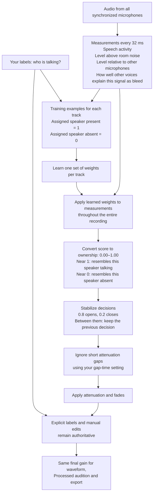

# How ownership is estimated

Ownership estimates whether the assigned speaker is speaking on their own track, rather than that microphone merely hearing somebody else. It is not the gain level or a guarantee of accuracy. The current acoustic mode trains one small logistic regression model per track from the session's human examples.

For example, a label saying only Speaker 3 is talking teaches Track 3 a positive example and Tracks 1/2 negative examples—even though their microphones also hear Speaker 3. Overlap labels can teach multiple tracks positive examples at the same time. Room tone teaches every track an absent-speaker example. Labels train the whole recording; they do not limit where processing happens.

The measurements include fixed speech detection (Silero VAD), signal levels relative to calibrated room noise and other microphones, and directed bleed features: explanation, expected level, excess residual, reliability and whether an expected level was identified. Nemotron adds mapped speaker activity only when explicitly enabled.

Training normalizes each measurement using the examples' mean and standard deviation, drops constant dimensions, and fits regularized logistic regression. For a new frame:

`score = intercept + sum(weight × normalized_measurement)`

`ownership = 1 / (1 + exp(-score))`

Each track has an independent estimate, so overlap is possible and the track values need not sum to one. An ownership of 0.90 is a fitted model estimate; it is not a verified 90% accuracy rate. Manual gain edits change the final gain without changing the estimated ownership. Missing or invalid evidence retains internal protection even though the review queue is removed.

The gap-time setting controls brief automatic attenuation gaps after ownership inference. It is distinct from probability hysteresis and fade duration. Increasing it keeps phrases open longer and can retain more bleed; decreasing it follows short changes more closely and can expose unwanted dips between words.
