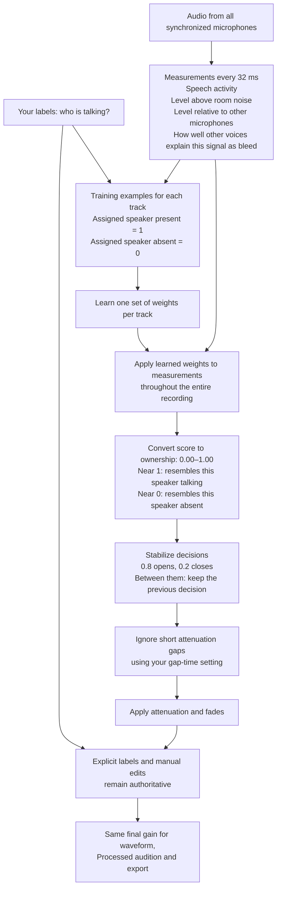

# How CleanSlate determines microphone ownership

Ownership estimates whether the assigned speaker is speaking on their own track, rather than that microphone merely hearing somebody else. It is not the gain level or a guarantee of accuracy. The current acoustic mode trains one small logistic regression model per track from the session's human examples.



For example, a label saying only Speaker 3 is talking teaches Track 3 a positive example and Tracks 1/2 negative examples—even though their microphones also hear Speaker 3. Overlap labels can teach multiple tracks positive examples at the same time. Room tone teaches every track an absent-speaker example. Labels train the whole recording; they do not limit where processing happens.

The measurements include fixed speech detection (Silero VAD), signal levels relative to calibrated room noise and other microphones, and directed bleed features: explanation, expected level, excess residual, reliability and whether an expected level was identified. Nemotron adds mapped speaker activity only when explicitly enabled.

Training normalizes each measurement using the examples' mean and standard deviation, drops constant dimensions, and fits regularized logistic regression. For a new frame:

`score = intercept + sum(weight × normalized_measurement)`

`ownership = 1 / (1 + exp(-score))`

Each track has an independent estimate, so overlap is possible and the track values need not sum to one. An ownership of 0.90 is a fitted model estimate; it is not a verified 90% accuracy rate. Manual gain edits change the final gain without changing the estimated ownership. Missing or invalid evidence retains internal protection even though the review queue is removed.

The gap-time setting controls brief automatic attenuation gaps after ownership inference. It is distinct from probability hysteresis and fade duration. Increasing it keeps phrases open longer and can retain more bleed; decreasing it follows short changes more closely and can expose unwanted dips between words.

## Architecture and source audio

CleanSlate validates and decodes synchronized mono tracks, then prepares 16 kHz analysis copies. Each person has one dedicated microphone track. Fixed speech measurements, acoustic calibration and a learned ownership model produce decisions over the whole recording. Automatic gain combines with manual edits and protection into one effective envelope shared by display, audition and export.

Processing applies gain to the original decoded audio at its native sample rate. Analysis copies do not replace the source. Bleed estimation does not subtract another microphone's signal from delivered audio. Original source files remain unchanged.

This document describes the current acoustic-first implementation. Nemotron-assisted analysis is experimental work in progress and defaults off. Its benefit over acoustic-only analysis has not been established. Independent recording quality and owner listening acceptance remain pending.

## What your labels teach

Drag a clear example and select everyone speaking. Selecting nobody means room tone, one person means solo speech, and several people means overlap.

| Label | Answer for Track 1 | Track 2 | Track 3 |
| --- | --- | --- | --- |
| Speaker 1 only | Own speech | Not own speech | Not own speech |
| Speaker 3 only | Not own speech | Not own speech | Own speech |
| Speakers 1 and 2 | Own speech | Own speech | Not own speech |
| Room tone | Not own speech | Not own speech | Not own speech |

Solo references for each assigned speaker and a room-tone reference are required. A few clear examples spread across the recording can describe different levels and microphone conditions. You do not need to label the entire podcast.

Labels supply training truth and constrain decisions inside their time ranges. Predictions run across unlabeled sections too. The system does not turn its own predictions into new training labels. Manual gain edits control final sound directly and remain authoritative across reanalysis; they do not teach the model.

## How bleed is estimated

Bleed calibration is learned from solo references. Detection elsewhere uses that calibration and measurements of the synchronized microphones. There is no separate required "bleed" label.

When you label "Speaker 3 only," the system observes direct speech on Track 3 and that person's leakage on Tracks 1 and 2. It estimates how that source relates to each receiving microphone, including expected leakage level and fit reliability.

These relationships are directed. Speaker 3 leaking into microphone 1 has its own calibration; Speaker 1 leaking into microphone 3 has another. Microphone distance, direction, gain and room acoustics can make them different.

For each new moment, the acoustic measurements describe how well another microphone explains this signal as bleed, the expected leakage level, additional sound above that prediction, and the reliability and availability of the calibration. The regression combines this evidence with speech activity and relative levels. It does not simply choose the loudest microphone.

Clear solo references containing ordinary leakage help calibrate these relationships. Substantial microphone movement or level changes can make earlier calibration less representative. Add examples describing the changed conditions and Analyze again.

## Inputs to each ownership model

Fixed Silero VAD supplies speech-activity measurements from 16 kHz audio in 512-sample steps, or 32 milliseconds. Silero can register bleed as speech, so it does not establish ownership by itself.

| Measurement | Meaning |
| --- | --- |
| Raw speech activity | Silero's estimate of speech presence on this track. |
| Local noise-relative level | This track's level above its calibrated room-noise floor. |
| Relative dominance | This track's level compared with the strongest other microphone. |
| Bleed explanation, per other track | Pairwise evidence explaining this signal as leakage. |
| Expected bleed level, per other track | The level estimated by directed acoustic calibration. |
| Excess residual, per other track | Sound above what the bleed relationship predicts. |
| Fit reliability, per other track | How trustworthy that calibration is. |
| Calibration availability, per other track | Whether an expected bleed level was identified. |

With three microphones, each model receives 13 acoustic-mode inputs: three general measurements and five for each of the two other microphones. Level measurements are scaled in the feature recipe, then training normalizes the usable inputs.

The experimental Nemotron path adds mapped activity for the assigned speaker when explicitly enabled. Human solo references map its speaker channels to the project's assigned speakers. Whether this additional input improves ownership and final audio is still an evaluation question. Acoustic-only mode does not require Nemotron, anonymous speaker mapping, transcripts or voice-identity embeddings.

## Weights and logistic regression

CleanSlate trains independent binary logistic regression models locally using Rust's Linfa and linfa-logistic libraries. Each model distinguishes its track's own speech from that person's absence. Training does not fine-tune Silero or Nemotron.

A weight controls how strongly a measurement affects the decision. A positive weight pushes toward ownership as that measurement increases. A negative weight pushes toward absence. Magnitude describes influence on the normalized measurement; raw inputs have different units, so their unnormalized numbers cannot be compared directly.

Training calculates each input's mean and standard deviation from the examples and drops constant dimensions:

```text
normalized_measurement = (measurement - training_mean) / training_standard_deviation
score = bias + sum(weight × normalized_measurement)
ownership = 1 / (1 + exp(-score))
```

The bias, also called the intercept, is the starting score before measurements contribute. Training adjusts it and the weights to reduce disagreement with the labels. The logistic function turns the combined score into a smooth value between 0 and 1. The same calculation evaluates unlabeled frames.

| Combined score | Approximate ownership |
| ---: | ---: |
| -4 | 0.018 |
| -2 | 0.119 |
| 0 | 0.500 |
| 2 | 0.881 |
| 4 | 0.982 |

### Regularization and iterations

Current training uses mean-loss L2 regularization of 0.01 and a maximum of 300 optimization iterations. The intercept is not regularized.

Regularization penalizes large weights. Increasing it discourages fitting the examples too strongly. Decreasing it allows a closer fit but can make the model learn quirks of those examples. It is not a direct attenuation-aggressiveness control.

An iteration is an optimizer step toward better weights. The maximum is a ceiling, not a required amount of learning. More iterations can help when optimization has not converged. Once it converges, a larger limit generally adds no benefit. Training validates the fit rather than accepting it simply because its iteration budget ended.

These settings are currently internal. The [deferred advanced training panel](../.scratch/offline-supervised-editor/issues/17-advanced-training-panel.md) records future controls and diagnostics. See [supervised ownership models](supervised-ownership-models.md) for the technical recipe and validation details.

## How decisions become sections and gain

Acoustic mode uses probability hysteresis. At or above 0.8, it starts preserving speech. At or below 0.2, it stops preserving automatically. Between those thresholds, it keeps the previous decision. These internal thresholds are separate from learned weights. Human labels constrain decisions, and missing or invalid evidence retains internal protection.

Consecutive decisions form timeline spans. **Ignore gaps shorter than** bridges brief, bounded automatic attenuation gaps between preserved spans. Its range is 10 to 5000 ms and its default is 768 ms. A gap exactly as long as the chosen duration still qualifies for attenuation. Gap handling cannot erase explicit room-tone truth or override manual edits.

Attenuation sets how far gain falls in non-speaking spans. Open and close fades shape transitions without shortening protected speech. Manual edits and protection compose with automatic gain to produce the effective envelope. Processed audition applies that envelope; Removed audition lets you hear what processing takes away.

## What changes require analysis

| Change | Behavior |
| --- | --- |
| Speaker labels or assignments | Mark analysis stale; Analyze recalibrates and retrains while reusing compatible fixed measurements. |
| Nemotron mode | Requires Analyze with the explicitly selected mode. |
| Attenuation, gap duration or fades | Update gain from cached ownership without retraining. |
| Manual edits or protection | Update effective gain without changing ownership estimates. |
| Future regularization or iteration controls | Require Analyze and a new trained-model identity. |

Source identities, labels, recipes, models and settings bind the result to its inputs. Cancelled, failed or obsolete jobs cannot replace the last accepted result. Final export requires current analysis and gain.

## Limits and corrections

The model learns relationships in this recording, not a universal identity for each voice. Similar speech and bleed measurements, sparse examples, noise, movement and changing microphone levels can produce incorrect decisions. A high score alone does not prove correctness.

Audition Original, Processed and Removed. Add representative labels when detection needs better examples; use manual attenuation or protection for a direct sound correction. Development fixtures and automated tests do not replace independent recording evaluation or owner listening approval.

## Implementation references

- [Session composition and inputs](../src/session_ownership.rs)
- [Acoustic measurements and bleed evidence](../src/acoustics.rs)
- [Training, normalization and inference](../src/ownership_model.rs)
- [Temporal ownership decisions](../src/temporal_ownership.rs)
- [Accepted architecture](adr/0006-offline-supervised-editable-envelopes.md)
