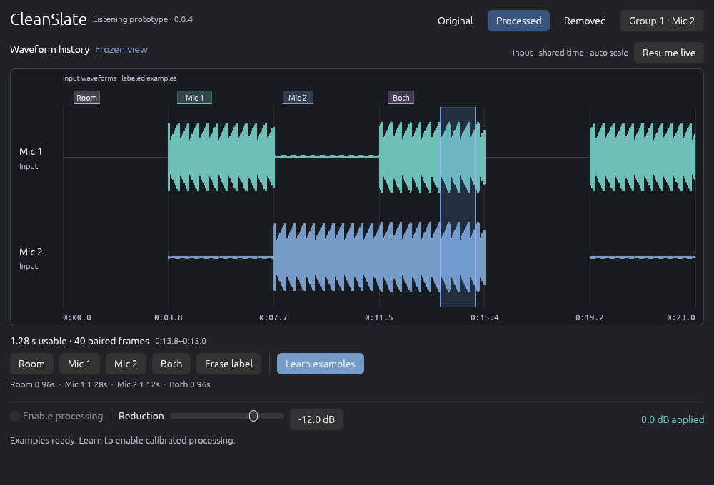

# CleanSlate plugin 0.0.4: waveform history and retrospective labels

The owner confirmed play → freeze history → drag-select → label, replacing 0.0.3's timed capture buttons. The checked Windows candidate is published through the existing project development links. Ticket 78 stays open for owner native UI/listening acceptance.

This is a CPU rendering of the actual egui editor code and its font textures with deterministic synthetic input. It is not a design mockup, an FL Studio capture, or proof of native GPU/window behavior. The [compact rendering](images/plugin-history-compact-0.0.4.png) uses the same editor at 760×620; the default is 1000×680. Both layouts and the empty state were inspected; software bounds assertions ensure controls remain inside those test viewports.

## Implemented

- Approximately 30 seconds of two synchronized original-input waveforms, using real min/max peaks across channels. Both lanes use shared automatic display scaling without changing audio. History is bounded and receives paired native 32 ms features alongside eight waveform bins per frame; no full recording or raw PCM is persisted.
- Freeze pins an immutable view while the DAW continues. Dragging either lane selects one source-time range across both. Room/Mic 1/Mic 2/Both label complete paired frames; Erase removes selected labels. Readiness shows usable duration for each class and enables Learn after the required classes reach ten frames each.
- Labels remain after live history overwrites and unlearned examples persist in both plugin states. Replacing/removing labels invalidates the old model until Learn. Reopened pending edits cannot silently confirm an older model. Source/microphone identity remains manually confirmed, as before.
- Old frozen views reject edits after seek/reconnect. State-revision guards prevent label/clear/confirm/learning actions from overwriting a newly loaded preset before reactivation. Model publication preserves the history cursor while decision caches warm up conservatively.
- The application's existing dark surface, panel, text, muted, teal waveform and blue action palette replace the form styling. Audition stays visible; group/member/fades/diagnostics move into settings. Waveforms explicitly show input; no processed trace is fabricated from the current gain meter.

The old private live-capture helpers remain for existing calibration fixtures; timed capture is no longer exposed in the editor. The current module's allocation-free predictor, delay budget, finite fades, attenuation limits and CLAP attenuation block are retained.

## Verification and artifact identity

`scripts/build-fl-probe.ps1` passed formatting, 28 tests, strict all-target Clippy, DLL/examples builds, actual CLAP/VST3 checks, candidate hashes, backup preservation and publication. Tests include actual egui pointer drag, full/compact rendering, font/CPU-renderer checks, peak bins including stereo cancellation, bounded immutable snapshots, paired gaps, relabel/removal, pending-state round-trip, stale preset protection, history continuity across model publication, and existing learned DSP preservation/fallback/tail/seek/monitoring cases. New nonblocking history writes introduce no callback allocation or mutex; actual wrappers retain allocation assertions.

CLAP: 1,858 bit-exact blocks, 1,168 shared windows, legacy state migration/round-trip and editor API checks; 0.48 seconds and 18.61 MiB largest sampled peak working set. VST3: 4,048 disabled/delayed-uncalibrated bit-exact blocks, 3,392 shared windows, correct latency/tail and editor interface construction/release; 0.72 seconds and 20.08 MiB. Working-set sampling is every 10 ms for the test child, excluding compiler/PowerShell. Learned-model gain is exercised by the separate paired streaming unit regression, not a native GUI-driven host session.

Both candidate and linked binaries have SHA256 `a8aead9c0a1d12e54cf05e06b6212b72e991427887271248e66b1f658ecb281c`:

- `C:/Users/User/Documents/podcast-automix-rust-gui/dist/fl-probe/CleanSlate FL Probe.clap`
- `C:/Users/User/Documents/podcast-automix-rust-gui/dist/fl-probe/CleanSlate FL Probe.vst3/Contents/x86_64-win/CleanSlate FL Probe.vst3`

Both standard-location links were read and independently matched those hashes. The previous 0.0.3 binary `d2878255443e4e522cea011a8944b4de97bd749e78c0ca8702302418025c74d2` is preserved under `%LOCALAPPDATA%/CleanSlate/VerifiedBuilds/fl-probe/`; an intermediate checked 0.0.4 is preserved there too. Source is development at base `88dda154daa9f442018302e19f1c792513fd0874` plus this uncommitted implementation and prior work. Pinned Rust 1.99.0, locked/offline dependencies and the shared local Cargo target/profile were used. No new dependency, desktop algorithm change, commit/push/release, DAW/window launch or owner-project modification occurred in this pass. Desktop checks from the shared-model extraction remain recorded in ticket 78; unchanged desktop tests were not rerun for this independent plugin editor change.

## Owner check

Restart/rescan FL Studio and open **CleanSlate FL Probe VST3 0.0.4** on both microphone tracks. Confirm group/member assignments in the header settings. Play a section, freeze, drag-select and label known room/solo/overlap examples; make one correction with Erase/relabel. Learn and audition both instances, then save/reopen and verify pending labels/calibration. The [plugin guide](../../plugins/fl-probe/README.md) contains the full workflow.

Native attachment/resizing/DPI, mouse feel and FL's delay compensation, real quiet speech/overlap and export still require owner checks. A frozen view neither pauses nor seeks/replays the DAW. CLAP attenuation remains disabled; VST2, additional platforms and source separation remain outside this candidate.
