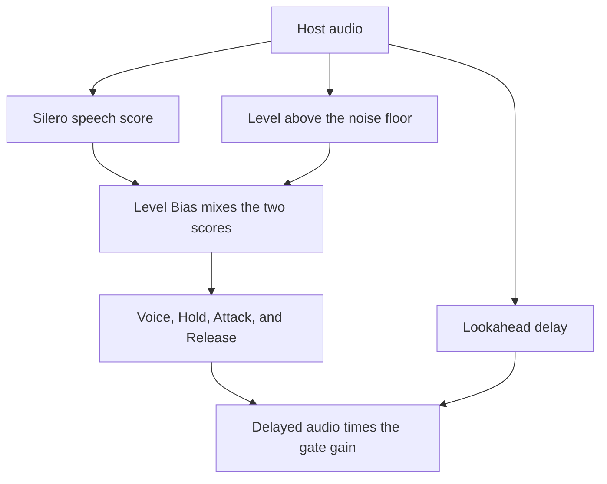

# CleanSlate Smart Gate

CleanSlate Smart Gate is a separate Windows VST3 for one microphone. It listens for speech and turns the channel down when nobody is talking. The desktop app stays the tool for a finished multitrack podcast. This plug-in is the live gate.

Preview version 0.1.0. It does not inherit the desktop app's stable 1.0.0 workflow or saved-project promise.

## Why it exists

The desktop app works well after a recording, because it can learn who is speaking on each microphone. I still wanted a gate I could use while talking: OBS, TikTok Live, a podcast recorded live, or any other session where there is one vocal and no time to label tracks.

This preview loads in a host that supports 64-bit VST3 on Windows, such as FL Studio or REAPER. OBS Studio 33.0.1 does not load VST3, and TikTok Live does not host a VST. For a stream, follow [Use it with OBS](#use-it-with-obs).

## Download

The [Smart Gate VST3 workflow](../.github/workflows/smart-gate-vst3.yml) builds one zip, `CleanSlate-Smart-Gate-0.1.0-windows-x64-vst3.zip`. Running that workflow by hand uploads the zip as an Actions artifact. A tag named `smart-gate-v0.1.0` can attach the same zip to a draft GitHub release. Until one of those runs is published, there is no public download on the Releases page.

The zip contains `CleanSlate Smart Gate.vst3`, the speech-detector DLL beside the plug-in binary, the GNU AGPL-3.0, and the Silero and ONNX notices. This preview is released under the AGPL-3.0 because the window is built with JUCE. The desktop app in this repository stays MIT. Source for the plug-in is this repository.

Copy the `.vst3` bundle to `C:\Program Files\Common Files\VST3`, then rescan plug-ins in the host. Remove the plug-in from the host before replacing the bundle. A host that already has it open keeps the previous file locked.

There is no installer. The zip is VST3 only. CLAP, VST2, AU, and AAX are not in this preview.

## Use it with OBS

OBS Studio 33.0.1 names its built-in filter "VST 2.x Plug-in". The [OBS knowledge base](https://obsproject.com/kb/vst-2-x-plugin-filter) says VST3 is not supported. The 33.0.1 scanner looks for `.dll` files, not `.vst3` bundles. Copying Smart Gate to `C:\Program Files\Common Files\VST3` lets FL Studio find it. It does not put Smart Gate in OBS's plug-in list. The source check is [the OBS routing note](research/obs-vst3-routing-2026-10-31.md).

Use a VST3 host, then hand OBS the processed audio:

1. Install the bundle as above, then scan plug-ins in FL Studio or REAPER. FL Studio's manual names `C:\Program Files\Common Files\VST3` for 64-bit VST3. Put Smart Gate on a mono or stereo track. The input and the output have to match.
2. Install [VB-Audio VB-CABLE](https://vb-audio.com/Cable/). In the host, send the processed output to CABLE Input. In FL Studio, FL Studio ASIO can select that Windows playback device. A manufacturer ASIO driver is for the audio interface, and this path does not claim OBS hears that driver.
3. In OBS, add an Audio Input Capture source and choose CABLE Output. Leave the dry microphone out of OBS. Do not also select the cable under Settings, Audio, or the stream hears the voice twice.
4. Set the host and OBS to the same rate. OBS offers 44.1 kHz and 48 kHz. Use one of those. Smart Gate can also run at 96 kHz, and OBS 33.0.1 has no 96 kHz setting.

Hear yourself from the host's own playback device. The delay is the host buffer, then the cable, then OBS. That chain has not been timed with Smart Gate.

OBS can also capture a host with Application Audio Capture. That source is still marked beta in 33.0.1, and it only applies when the host is playing through Windows audio. The cable above is the path to write down.

A filter inside OBS would be the short install. Official VST3 hosting is [open pull request 12752](https://github.com/obsproject/obs-studio/pull/12752). It is not in OBS 33.0.1. OBS has not shipped a CLAP host either. A CleanSlate OBS module does not exist yet. Do not ship a VST2 copy so the old filter can load it. Steinberg stopped licensing VST2.

### A shell you already own

Waves, Blue Cat, and DDMF sell a VST2 plug-in that hosts other plug-ins. That is the Patcher shape, and it can sit in OBS's existing VST 2.x filter. FL Studio Patcher itself stays inside FL Studio.

Waves tells OBS users to add a VST 2.x filter and pick `Waves StudioRack for OBS.dll`. Their OBS article then lists Waves plug-ins. Their separate scan for other companies' VST3 plug-ins is written for StudioRack in a DAW. Waves lists OBS Studio 32, stereo only. OBS 33 is not on that list. [Waves in OBS](https://www.waves.com/support/how-to-use-waves-plugins-in-obs)

Blue Cat PatchWork and DDMF Metaplugin each publish a VST build and say that build can load VST3. Someone who already owns one can try it: add their VST2 in OBS, then load CleanSlate Smart Gate from `C:\Program Files\Common Files\VST3`. Smart Gate has not been loaded in either shell. The shell runs inside OBS, so a fault in the plug-in can take OBS down. The cable path keeps that fault in the other program. Details and links are in [the routing note](research/obs-vst3-routing-2026-10-31.md).

## What you can control

The plug-in starts with Bypass off. The host remembers these controls in the project.

| Control | Range | Default | What it changes |
| --- | --- | --- | --- |
| Bypass | on or off | off | Passes the host audio without the gate. The Lookahead delay stays, so the host's latency does not jump. |
| Voice | 0 to 1 | 0.10 | Speech score that opens the gate. A lower score closes it. |
| Depth | 0 to 60 dB | 6 dB | How far a closed gate turns the channel down. 60 dB is silence. |
| Attack | 1 to 1000 ms | 5 ms | How long the gate takes to open. |
| Hold | 0 to 1000 ms | 300 ms | How long the gate stays open after speech drops. |
| Release | 1 to 1000 ms | 250 ms | How long the gate takes to close. |
| Lookahead | 0 to 20 ms | 5 ms | Delays the output so the gate can open before a word. The plug-in reports that delay to the host. |
| Level Bias | 0 to 100% | 0% | Mixes a loudness score into the speech score. At 0%, only the speech detector decides. |

Shift makes a fine change. Ctrl-click resets a control. Double-click types a value.

The plot shows the incoming audio and the gain the gate is applying. Status words are Open, Moving, Closed, Bypassed, Waiting, and Detector unavailable. At any other sample rate the window says to use 44.1, 48, or 96 kHz.

## How it works

The host sends one channel or a stereo pair. A stereo pair shares one speech decision. The plug-in asks the same Silero speech model used by the desktop app whether the current sound is speech. That model is stored at `assets/silero_vad.onnx` and runs locally. Supported rates are 44.1 kHz, 48 kHz, and 96 kHz.

Level Bias can pull that speech score toward a second number: how far the current level sits above a slow noise floor. At 0% the floor is ignored. A louder non-speech sound can then hold the gate open as the bias rises. Quiet speech does not get a free pass from the bias.

Voice is one line. At or above it, the gate opens and Hold keeps it open. Below it, the gate closes. Attack and Release move the gain between full level and the Depth floor. Lookahead writes the current samples into a short delay and multiplies the older samples by the gain, so a word can open the gate before its first sample leaves the plug-in.

If the detector is missing, the rate is unsupported, or the audio is not finite, the plug-in does not gate. A running session keeps the Lookahead delay while Bypass is on.

The desktop app takes the speech score and then learns which person owns each microphone. Smart Gate does not do that. It has one input, no speaker labels, and no bleed model. The decision record is [ADR 0007](adr/0007-smart-gate-activity-blend.md). The desktop path is [How CleanSlate reduces microphone bleed](ownership-explained.md).

## What this preview does not do

- It does not learn a session, reduce another speaker's bleed, or level a vocal.
- It does not load in OBS's built-in VST list or inside TikTok Live.
- It accepts a mono track or a stereo track. A stereo track shares one decision, and the input and output layouts have to match.
- It does not ship a Mac or Linux build.
- Bypass takes the gate out of the audio and keeps the Lookahead delay, so toggling it does not shift the vocal.
- Listen before a stream. A speech score is an estimate, and Depth can remove room tone along with the pauses.

## Where the code lives

The preview stays in this repository. `plugins/gate-detector` runs the shared model, `plugins/smart-gate` applies the gain, and `plugins/juce-gate` is the VST3 window. Build the Rust library first, then the VST3, and copy `cleanslate_smart_gate.dll` into `CleanSlate Smart Gate.vst3/Contents/x86_64-win/` next to the plug-in binary. The Windows workflow does those steps.

Older notes in `plugins/smart-gate/README.md` and [the product split](plugin-products.md) describe earlier CLAP and probe work. They are not the control layout of this VST3.
